<p align="center">
  
</p>

<p align="center">
  
  <a href="LICENSE"></a>
  
  
</p>

# SmartTest

SmartTest runs only the tests a change can affect. It builds a dependency graph of a TypeScript or JavaScript repository (files, symbols, imports, tests), finds what a change reaches, and runs those tests through the project's own runner: Jest, Vitest or `node --test`. Every selected or skipped test comes with the reason.

Status: 0.5.0 alpha. It runs in the pre-commit hook of [LeadsIt](documentation/case-studies/leadsit.md). It is not on npm yet (the package name is still being decided, [ADR-0007](documentation/architecture/adr/0007-name-license-distribution.md)). Next steps are in the [roadmap to 1.0.0](documentation/planning/roadmap.md).

## Usage

```bash
npx smarttest init --dry-run      # show the detected setup and every file it would write
npx smarttest init --yes          # write it (re-running changes nothing; `init --rollback` undoes it)

npx smarttest run                 # tests affected by uncommitted changes
npx smarttest run --staged        # tests affected by staged changes (pre-commit hook)
npx smarttest run --base main     # tests affected by the current branch
npx smarttest run --all           # every test, through the same pipeline

npx smarttest explain <test|file> # why a test was selected or skipped, or which tests cover a file
npx smarttest trace               # record which code each test runs; later selections use it
npx smarttest benchmark           # replay recent commits: full run vs SmartTest, with misses checked
```

Until the package is published, build it from this repository (see [Development](#development)) and install the tarball: `pnpm release:pack`, then `npm install -D <path>/smarttest-0.5.0.tgz`.

## How it works

<p align="center">
  
</p>

1. Changes come from Git (staged, uncommitted, branch, commit range) or from local snapshots when there is no VCS.
2. Changed lines are mapped to symbols and classified: comment-only, formatting, implementation, signature, exported API.
3. The graph is walked backwards from the changed symbols to every test that can reach them. Methods are nodes of their own, so a change to one method reaches the callers of that method, not every user of the class. The walk follows imports, re-exports, barrels, workspace packages, path aliases, inheritance, CommonJS exports and computed `import()` paths it can evaluate. Environment keys, Prisma models, translation keys, files read through `fs`, snapshots and manual mocks are nodes too.
4. If `smarttest trace` has recorded which functions each test ran, a test that static analysis reaches but that never ran the changed code is skipped (not in SAFE mode).
5. Rules and safety modes widen the selection where needed: global config files, critical paths, and imports that cannot be resolved.
6. The selected tests run through the project's runner with its own config. Skipped tests are reported as not run, never as passed.

<p align="center">
  
</p>

```text
$ npx smarttest explain src/catalog/CatalogService.test.ts

SKIPPED (not run)  src/catalog/CatalogService.test.ts
Reasons
  • No static dependency path from changed code
  • No mandatory trigger matched
  • No rule requires it
Confidence
  Limited to the analysed dependency model (0 file(s) with unresolved imports in its dependencies)
```

## Results on a real repository

LeadsIt has six independent projects, no root `package.json`, and three runners (Jest, Vitest with a custom config, `node --test`). It was migrated with `init --yes` and `run --staged` in its pre-commit hook. Running every test through SmartTest gives the same 706 results as the three runners.

Replay of 12 commits with `smarttest benchmark` (SmartTest 0.2.0):

|                 | Full suites | Previous hook (suites of touched projects) | SmartTest |
| --------------- | ----------- | ------------------------------------------ | --------- |
| Test time       | 110.3 s     | 37.2 s                                     | 13.8 s    |
| Test files run  | 1,192       |                                            | 9         |
| Missed failures |             |                                            | 0         |

With 0.5.0, 40 commits sampled from the last 200 replay with 0 missed failures, running 17% of the test files. Details, the 0.5.0 numbers and caveats: [case study](documentation/case-studies/leadsit.md).

## Features in 0.5.0

| Area      | What it does                                                                                                                                            | Commands                                                        |
| --------- | ------------------------------------------------------------------------------------------------------------------------------------------------------- | --------------------------------------------------------------- |
| Setup     | Detects projects, runners, frameworks, VCS, existing hooks and skipped tests; writes a config; idempotent and reversible                                | `init`, `doctor`, `scan`                                        |
| Changes   | Git staged, uncommitted, branch and commit ranges; native snapshots without VCS                                                                         | `run`, `impact`, `vcs`, `snapshot`                              |
| Analysis  | TS/JS symbols and class members, imports, CommonJS, JSX, decorators, semantic diff, env/Prisma/translation/asset edges, Wasp operations, mock awareness | `scan`, `graph`, `graph why\|cycles\|orphans`                   |
| Selection | Direct and transitive dependents, fast/balanced/safe modes, mandatory triggers, conservative fallbacks                                                  | `impact`, `run`                                                 |
| Rules     | Policies by path, package, class, method or decorator                                                                                                   | `rules list`, `rules validate`, `rules explain`                 |
| Runners   | Jest, Vitest, `node --test`; custom configs; discovery asks each runner which files it collects                                                         | `run`                                                           |
| Evidence  | Reasons per test, runtime traces, unprotected changes, comparison with a full run, Shadow Mode, history replay                                          | `explain`, `trace`, `validate-selection`, `shadow`, `benchmark` |
| Generator | Missing test files as `it.todo` scaffolds; never overwrites                                                                                             | `generate`                                                      |
| Reports   | HTML, JSON, JUnit, Markdown; coverage labelled full or selected                                                                                         | `report`, `coverage`                                            |

What SmartTest does not do: it never reports a skipped test as passed, never treats an unresolvable import as unrelated, never presents partial coverage as project coverage, and never overwrites a file without an explicit `--yes`. A report that breaks one of these rules fails its own integrity check (exit 70).

## Performance

Measured with `node benchmarks/run.mjs` on generated layered TypeScript repositories ([conditions](benchmarks/RESULTS.md)):

|                                 | 50 modules | 500 modules | 2,000 modules   | Target       |
| ------------------------------- | ---------- | ----------- | --------------- | ------------ |
| CLI startup                     | 80 ms      | 90 ms       | 80 ms           | under 300 ms |
| Selection on a warm graph       | 2 ms       | 11 ms       | 190 ms          | under 200 ms |
| Full analysis of a change, warm | 130 ms     | 180 ms      | 510 ms (missed) | under 500 ms |
| HTML report                     | under 1 ms | 3 ms        | 13 ms           | under 2 s    |

## Documentation

- [Getting started](documentation/guides/getting-started.md), [CI](documentation/guides/ci.md)
- [How selection works](documentation/concepts/how-selection-works.md), [safety model](documentation/concepts/safety-model.md), [change tracking](documentation/concepts/change-tracking.md), [rules](documentation/concepts/rules.md)
- [CLI reference](documentation/reference/cli.md), [configuration](documentation/reference/configuration.md)
- [Architecture](documentation/architecture/overview.md), [decision records](documentation/architecture/adr/README.md)
- [Roadmap to 1.0.0](documentation/planning/roadmap.md), [specification](documentation/product/PRD.md)

## Development

```bash
corepack enable
pnpm install
pnpm hooks:install     # pre-push runs `pnpm verify`; this repository has no hosted CI
pnpm verify            # lint, package boundaries, typecheck, tests, planning consistency
pnpm build             # compile all packages
pnpm release:pack      # self-contained `smarttest` tarball in packages/cli/.publish
node benchmarks/run.mjs
```

Packages live in `packages/` (27 workspace packages, mapped in `scripts/packages.manifest.json`). Fixture projects used by the integration tests and the regression harness live in `fixtures/projects/`. See [CONTRIBUTING.md](CONTRIBUTING.md) and, for coding agents, [AGENTS.md](AGENTS.md).

## License

Apache-2.0 ([LICENSE](LICENSE)). Security reports: [SECURITY.md](SECURITY.md).
