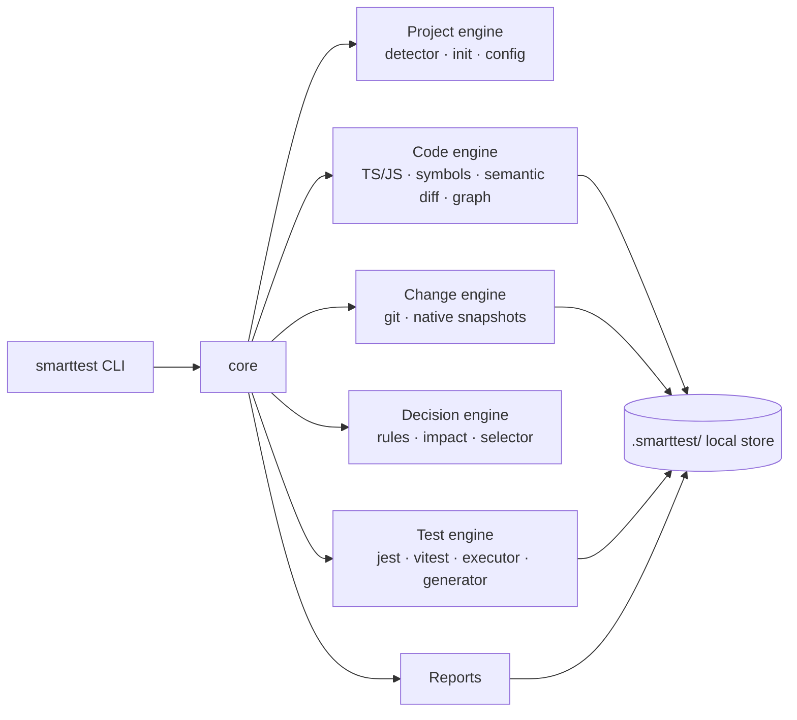

<p align="center">
  
</p>

<p align="center">
  <a href="documentation/planning/release-1.0.0/README.md"></a>
  <a href="documentation/planning/README.md"></a>
  <a href="LICENSE"></a>
  
  
  
</p>

<p align="center">
  <a href="#quick-start"><b>Quick start</b></a> ·
  <a href="#how-it-works"><b>How it works</b></a> ·
  <a href="documentation/README.md"><b>Docs</b></a> ·
  <a href="documentation/planning/release-1.0.0/README.md"><b>Road to 1.0</b></a> ·
  <a href="CONTRIBUTING.md"><b>Contributing</b></a>
</p>

> [!IMPORTANT]
> **v0.2.0 alpha, already running on a real product.** [LeadsIt](documentation/case-studies/leadsit.md) replaced its per-project test hook with SmartTest: 706/706 tests in parity, **88% less test time than full suites and 63% less than its old hook over 12 replayed commits, 0 missed failures**. SmartTest isn't on npm yet (the name is still being checked, [ADR-0007](documentation/architecture/adr/0007-name-license-distribution.md)); see [Try it](#try-it). Progress toward 1.0: 389 of 422 points ([epics](documentation/planning/release-1.0.0/epics/README.md)), then the [1.1 → 1.5 roadmap](documentation/planning/roadmap-1.x.md).

---

**SmartTest is a test-impact layer that works on top of the runners you already use.** It reads your TypeScript/JavaScript at the level of symbols, works out what a change can affect, and has **Jest**, **Vitest** or **`node --test`** run only the tests that protect that code. For every test it runs or skips, it records the reason.

- **For a 3-file change, run 12 tests instead of 486.** When the analysis is uncertain, SmartTest falls back to a wider run or the full suite.
- **Zero-config setup.** `smarttest init` detects your stack, explains its plan, shows a preview before writing, and can be rolled back.
- **A test structure that stays organised.** It generates and syncs test architecture from your source tree. It never overwrites your files.
- **Local and deterministic.** No account, no cloud, no telemetry. AI is optional and arrives later.

<br>

## How it works

<p align="center">
  
</p>

| Stage                | What happens                                                                                                                                          |
| -------------------- | ----------------------------------------------------------------------------------------------------------------------------------------------------- |
| **Changes**          | Git (branch, staged, uncommitted, renames) or **native snapshots** if there is no VCS. Both produce a normalized `ChangeSet` with a completeness flag |
| **Semantic diff**    | Changed lines are mapped to symbols and classified (comment-only, implementation, signature, exported API…), each with a confidence level             |
| **Dependency graph** | A persistent, incremental graph of imports, calls, inheritance and test links. Every edge records its provenance and confidence                       |
| **Rules & safety**   | Your policies (`risk: critical`, always-run), mandatory triggers (tsconfig, lockfiles, runner config) and FAST / BALANCED / SAFE modes                |
| **Selection**        | The smallest defensible set of tests. Any uncertainty widens the set                                                                                  |
| **Run & report**     | Tests run through your runner. Reports are HTML, JSON, JUnit and Markdown, and skipped tests are listed as _not run_                                  |

<br>

## See it run

<p align="center">
  
</p>

<br>

## Every decision has a reason

<p align="center">
  
</p>

```text
$ smarttest explain src/catalog/CatalogService.test.ts

SKIPPED (not run)  src/catalog/CatalogService.test.ts
Reasons
  • No static dependency path from changed symbols
  • No mandatory trigger matched · no rule requires it
Confidence
  Limited to the analysed dependency model (0 unresolved imports in the affected area)
```

You can also check selection against a full run before you rely on it: `smarttest validate-selection` runs both and reports any failure the selection would have missed.

<br>

## Quick start

> Commands as they will look once the package is published. To run them today, see [Try it](#try-it).

```bash
npm install -D smarttest

npx smarttest init --dry-run     # see the plan and every file it would touch
npx smarttest init               # apply it (idempotent · `init --rollback` undoes it)

npx smarttest run --affected     # analyse your changes, run what matters
npx smarttest explain <test>     # why was it selected, or why not
npx smarttest generate --sync    # missing / orphaned / renamed tests
npx smarttest benchmark          # replay recent commits: how much would SmartTest have saved?
```

In CI:

```bash
npx smarttest run --affected --base origin/main --mode balanced --non-interactive
```

See [GitHub Actions guide](documentation/guides/ci-github-actions.md) · [CLI reference](documentation/reference/cli.md) · [Configuration](documentation/reference/configuration.md).

<br>

## Try it

```bash
git clone https://github.com/RemiPelloux/SmarttyTest && cd SmarttyTest
corepack enable && pnpm install && pnpm build

# play with a fixture project: change a method, see what gets selected and why
cp -r fixtures/projects/nest-auth-vitest /tmp/demo && cd /tmp/demo
ln -s "$OLDPWD/fixtures/projects/nest-auth-vitest/node_modules" node_modules
git init -q && git add -A && git commit -qm init
sed -i.bak 's/token.length > 8/token.length > 9/' src/modules/auth/TokenManager.ts

node "$OLDPWD/packages/cli/dist/bin.js" run          # 4 of 7 tests selected, 3 not run
node "$OLDPWD/packages/cli/dist/bin.js" explain test/routes/ProtectedRoutes.test.ts
```

To use it in your own project, build the self-contained package (`pnpm bundle:cli`) and install `packages/cli/.publish` from its path.

<br>

## What ships in 1.0 (all working in v0.1.0)

|     | Capability                                                                                                                                            | Commands                                       | v0.1.0 |
| --- | ----------------------------------------------------------------------------------------------------------------------------------------------------- | ---------------------------------------------- | ------ |
| 🧭  | **Smart Init**: detection, explained plan, dry-run, safe merge, idempotent, rollback                                                                  | `init` · `doctor` · `scan`                     | ✅     |
| 🔀  | **Change intelligence**: Git and native snapshots, plus a hybrid of the two                                                                           | `vcs` · `snapshot`                             | ✅     |
| 🧠  | **Source intelligence**: TS/JS symbols, imports, classes, exports, semantic diff                                                                      | `graph`                                        | ✅     |
| 🎯  | **Impact selection**: direct + transitive, FAST/BALANCED/SAFE, mandatory triggers, safe fallback                                                      | `impact` · `run --affected`                    | ✅     |
| 💬  | **Explainability & trust**: reasons for every decision, full-run comparison, history replay                                                           | `explain` · `validate-selection` · `benchmark` | ✅     |
| 📐  | **Rules engine**: by path, package, class, method, decorator                                                                                          | `rules list / validate / explain`              | ✅     |
| 🏃  | **Jest, Vitest & node:test adapters**: custom configs, runner-accurate discovery, honest statuses, timeouts, cancellation, retries with flaky marking | `run`                                          | ✅     |
| 🗂️  | **Test architecture generator**: mirror/colocated/custom layouts, templates, `it.todo` scaffolds, sync                                                | `generate`                                     | ✅     |
| 📊  | **Reports**: self-contained HTML, JSON (versioned schema), JUnit, Markdown, coverage scope                                                            | `report` · `coverage`                          | ✅     |

Planned for later releases: adaptive `sync`, SVN, runtime tracing, watch mode and result cache (**Release 2**) · AI test engineering (**3**) · SmartTest Studio GUI (**4**) · Cloud (**5**) · Python/Java/Go (**6**). Details are in the [roadmap](documentation/planning/README.md).

<br>

## Real-world: LeadsIt

Six independent projects with no root `package.json`, three runners (Jest, Vitest with a custom config, `node --test`), Wasp-generated code and a submodule. It was set up with built-in commands only (`npm install`, `smarttest init --yes`, `smarttest run --staged` in the pre-commit hook):

| Last 12 commits, replayed with `smarttest benchmark` | Full suites | Old per-project hook | SmartTest  |
| ---------------------------------------------------- | ----------- | -------------------- | ---------- |
| Total test time                                      | 110.3 s     | 37.2 s               | **13.8 s** |
| Test files run                                       | 1,192       | —                    | 9          |
| Missed failures                                      | —           | —                    | **0**      |

Everything the migration exposed (nested projects, custom runner configs, `node:test`, `.gitignore`, computed `import()` paths…) was fixed in SmartTest itself, not worked around in LeadsIt. → [Case study](documentation/case-studies/leadsit.md)

<br>

## Performance

Measured with `node benchmarks/run.mjs` on synthetic layered TypeScript repos. Full conditions are in [benchmarks/RESULTS.md](benchmarks/RESULTS.md).

|                          | 50 modules | 500 modules | 2,000 modules | Target (PRD §31.3) |
| ------------------------ | ---------- | ----------- | ------------- | ------------------ |
| CLI startup              | ~80 ms     | ~90 ms      | ~80 ms        | < 300 ms           |
| Warm graph selection     | ~2 ms      | ~11 ms      | ~190 ms       | < 200 ms           |
| Warm end-to-end analysis | ~130 ms    | ~180 ms     | ~510 ms ❌    | < 500 ms           |
| HTML report              | < 1 ms     | ~3 ms       | ~13 ms        | < 2 s              |

Misses are reported as misses.

<br>

## Honest by design

SmartTest will **never**:

- report a skipped test as passed
- treat an unknown dependency as unrelated
- present partial coverage as project coverage
- reuse a result it can't prove is still valid
- silently ignore a change to global configuration
- overwrite your files without asking

These rules are enforced by tests: every run validates its own report through a [report integrity suite](documentation/planning/release-1.0.0/epics/REP-reporting-and-coverage-scope.md#st-090) and a [regression harness](documentation/planning/release-1.0.0/epics/QLT-reliability-and-performance.md#st-095) that fails CI if a known failure is missed. See the [safety model](documentation/concepts/safety-model.md).

<br>

## Principles

**Local-first** · **Framework-agnostic** (it orchestrates your runner, it doesn't replace it) · **Deterministic-first** · **AI-optional** · **Non-destructive** · **Explainable** · **Performance-aware** (it measures its own overhead) · **Extensible** (capability-declared adapters).

<br>

## Architecture



The [architecture overview](documentation/architecture/overview.md) covers the full package map and data flow, and the [ADRs](documentation/architecture/adr/README.md) record the decisions behind it.

<details>
<summary><b>Repository layout</b></summary>

```text
.
├── packages/                  26 workspace packages for v1.0.0 (see scripts/packages.manifest.json)
│   ├── shared/                spec contracts, SmartTestError, exit codes
│   ├── config/  plugin-sdk/   defineConfig · adapter contracts
│   ├── project-detector/  smart-init/
│   ├── vcs-core/  vcs-git/  native-snapshots/
│   ├── source-parser/  language-typescript/  language-javascript/  symbol-index/  semantic-diff/
│   ├── dependency-graph/  rules-engine/  impact-engine/  test-selector/
│   ├── test-discovery/  test-executor/  adapter-vitest/  adapter-jest/  coverage-engine/
│   ├── test-generator/  report-engine/
│   ├── core/                  orchestration API
│   └── cli/                   → published as `smarttest`
├── documentation/
│   ├── product/PRD.md         master specification (v2.0)
│   ├── architecture/          overview + ADRs
│   ├── concepts/ guides/ reference/
│   ├── design/                design system + motion design
│   ├── planning/              roadmap + v1.0.0 charter, sprints, epics, stories
│   └── assets/                generated animated SVGs
├── fixtures/projects/         real Vitest/Jest projects + seeded mutations (expected.json)
├── integration-tests/         end-to-end, CLI, regression harness (0 missed failures)
├── benchmarks/                run.mjs + RESULTS.md
└── scripts/
    ├── scaffold-package.mjs   manifest-driven, non-destructive package scaffolder
    ├── brand/                 README/docs motion assets generator
    └── planning/              backlog → docs/CSV generator · GitHub issues importer
```

</details>

<br>

## Road to 1.0

| Milestone              | Version       | Sprint | Cumulative points | What it proves                                  |
| ---------------------- | ------------- | ------ | ----------------- | ----------------------------------------------- |
| M0 Foundation          | —             | S0     | 39 / 422          | Monorepo, contracts, fixtures, CI on 3 OSes     |
| M1 Change intelligence | `0.1.0-alpha` | S3     | 150 / 422         | `scan`, `vcs`, `snapshot`, persisted graph      |
| M2 First affected run  | `0.3.0-alpha` | S6     | 268 / 422         | `run --affected` + `explain`, 0 missed failures |
| M3 Init & generate     | `0.6.0-beta`  | S8     | 348 / 422         | `init`, `generate`, `doctor`. Public beta       |
| M4 Release candidate   | `1.0.0-rc.1`  | S9     | 389 / 422         | Reports, `validate-selection`, feature freeze   |
| **M5 GA**              | **`1.0.0`**   | S10    | **422 / 422**     | Benchmarked, cross-platform, signed             |

The plan has **103 user stories (422 points) across 15 epics and 11 sprints of 40 points**: [charter](documentation/planning/release-1.0.0/README.md) · [sprints](documentation/planning/release-1.0.0/sprints.md) · [epics & stories](documentation/planning/release-1.0.0/epics/README.md) · [CSV for Jira/Linear/GitHub](documentation/planning/release-1.0.0/backlog.csv).

<br>

## Developing SmartTest

```bash
corepack enable            # or: npx pnpm@12 …
pnpm install
pnpm verify                # lint · boundaries · typecheck · 112 tests · planning consistency

pnpm scaffold:package --all        # (re)generate package boilerplate from the manifest
pnpm assets:build                  # regenerate the animated SVGs in documentation/assets
pnpm planning:build                # regenerate epics/sprints/CSV from backlog.data.mjs
pnpm planning:issues               # dry run: GitHub labels, milestones and issues for every story
pnpm bundle:cli                    # self-contained `smarttest` package in packages/cli/.publish
node benchmarks/run.mjs            # performance benchmarks → benchmarks/RESULTS.md
```

Start with [CONTRIBUTING.md](CONTRIBUTING.md). If you're an AI coding agent, read [AGENTS.md](AGENTS.md) first.

## Security

Please report vulnerabilities privately. See [SECURITY.md](SECURITY.md).

## License

[Apache-2.0](LICENSE) for the open-source core. _(Proposed in [ADR-0007](documentation/architecture/adr/0007-name-license-distribution.md).)_

<p align="center"><sub><b>Test less when it is safe. Test better everywhere. Know exactly why.</b></sub></p>
