<p align="center">
  
</p>

<p align="center">
  <a href="https://www.npmjs.com/package/@tkmremi/smarttest"></a>
  <a href="https://github.com/RemiPelloux/SmarttyTest/actions/workflows/ci.yml"></a>
  <a href="https://github.com/sponsors/RemiPelloux"></a>
  <a href="LICENSE"></a>
  
  
</p>

# SmartTest

SmartTest runs only the tests a change can affect. It builds a dependency graph of a TypeScript or JavaScript repository (files, symbols, imports, tests), finds what a change reaches, and runs those tests through the project's own runner: Jest, Vitest, `node --test`, Playwright, Cypress or Angular's `ng test`. Python (pytest, unittest) and PHP (PHPUnit, Pest, Laravel) are supported as previews, analysed without running Python or PHP. Every selected or skipped test comes with the reason.

Documentation site: [remipelloux.github.io/SmarttyTest](https://remipelloux.github.io/SmarttyTest/). It has a live example of the selection on the first screen.

Status: stable since 1.0.0; every 1.x release is additive. The config schema, exit codes and `--json` output are [frozen contracts](documentation/reference/contracts.md) that only change in a major version. It runs in the commit hooks of [LeadsIt](documentation/case-studies/leadsit.md) and OpenPro's repositories, and real histories replay with 0 missed failures ([1.0.0](documentation/case-studies/benchmarks-1.0.md), [1.2.0](documentation/case-studies/benchmarks-1.2.md)); `smarttest audit` injects faults to measure misses on your own project. CI checks it on Linux, Windows and macOS. Known limits are in the [delivery log](documentation/planning/delivery.md).

## Usage

```bash
npx smarttest init --dry-run      # show the detected setup and every file it would write
npx smarttest init --yes          # write it (re-running changes nothing; `init --rollback` undoes it)

npx smarttest run                 # tests affected by uncommitted changes
npx smarttest run --staged        # tests affected by staged changes (pre-commit hook)
npx smarttest run --base main     # tests affected by the current branch
npx smarttest hook install        # install the pre-commit profile (husky, lefthook, …)
npx smarttest hook install --pre-push # check committed changes before a push
npx smarttest studio --open       # local interface for impact, tests and selection evidence
npx smarttest ci                  # affected tests in any CI, base picked automatically
npx smarttest watch               # rerun affected tests on every save
npx smarttest run --all           # every test, through the same pipeline

npx smarttest explain <test|file> # why a test was selected or skipped, or which tests cover a file
npx smarttest trace               # record which code each test runs; later selections use it
npx smarttest benchmark           # replay recent commits: full run vs SmartTest, with misses checked
npx smarttest audit --mutate      # break functions one at a time and check the selection catches each
npx smarttest sync                # update the config after the project or SmartTest changed, as diffs
```

Install it in a project with `npm install -D @tkmremi/smarttest` (or `pnpm add -D @tkmremi/smarttest`). To try an unreleased build, run `pnpm release:pack` in this repository and install the tarball it writes.

## How it works

<p align="center">
  
</p>

1. Changes come from Git (staged, uncommitted, branch, commit range) or from local snapshots when there is no VCS.
2. Changed lines are mapped to symbols and classified: comment-only, formatting, implementation, signature, exported API.
3. The graph is walked backwards from the changed symbols to every test that can reach them. Methods are nodes of their own, so a change to one method reaches the callers of that method, not every user of the class. The walk follows imports, re-exports, barrels, workspace packages, path aliases, inheritance, CommonJS exports and computed `import()` paths it can evaluate. Environment keys, Prisma models, translation keys, files read through `fs`, snapshots and manual mocks are nodes too.
4. If `smarttest trace` has recorded which functions each test ran, a test that static analysis reaches but that never ran the changed code is skipped (not in SAFE mode).
5. Rules and safety modes widen the selection where needed: global config files, critical paths, and imports that cannot be resolved.
6. The selected tests run through the project's runner with its own config. Skipped tests are reported as not run, never as passed.

<p align="center">
  
</p>

```text
$ npx smarttest explain src/catalog/CatalogService.test.ts

[SKIPPED (not run)]  src/catalog/CatalogService.test.ts
Reasons
  • No static dependency path from changed code
  • No mandatory trigger matched
  • No rule requires it
Confidence
  Limited to the analysed dependency model (0 file(s) with unresolved imports in its dependencies)
```

## Results on real repositories

LeadsIt has six independent projects, no root `package.json`, and three runners (Jest, Vitest with a custom config, `node --test`). It was migrated with `init --yes` and `run --staged` in its pre-commit hook. Running every test through SmartTest gives the same 706 results as the three runners.

`smarttest benchmark --commits 200 --sample 40` with SmartTest 0.5.0 (40 commits spread over the last 200):

|                 | Full suites | Previous hook (suites of touched projects) | SmartTest |
| --------------- | ----------- | ------------------------------------------ | --------- |
| Test time       | 240.7 s     | 82.9 s                                     | 88.3 s    |
| Test files run  | 3,052       |                                            | 522 (17%) |
| Missed failures |             |                                            | 0         |

Four public repositories (commander.js, path-to-regexp, ufo, defu) set up with `init --yes` and no configuration edits also replay with 0 missed failures ([results](documentation/case-studies/external-repositories.md); [1.0.0 benchmarks](documentation/case-studies/benchmarks-1.0.md)).

SmartTest saved 63% of the full-run time. It was 6% slower than the previous hook over these commits: on single-project commits the hook runs one small suite, and SmartTest's analysis time counts in full. On the 12 most recent commits, with `--traces`, it also found 0 missed failures. Details and caveats: [case study](documentation/case-studies/leadsit.md).

OpenPro's four JavaScript repositories, replayed for 1.2.0, show 0 missed failures and 16–75% less test time; openpro-front runs 5 min 5 s of tests instead of 20 min 29 s over 8 commits ([benchmarks for 1.2.0](documentation/case-studies/benchmarks-1.2.md)). On OpenPro's Laravel backend (1,998 PHPUnit test files), 10 replayed commits give 0 missed failures and 47% less test time ([PHP guide](documentation/guides/php.md)).

## Features

| Area      | What it does                                                                                                                                                                                                                                                                            | Commands                                                                 |
| --------- | --------------------------------------------------------------------------------------------------------------------------------------------------------------------------------------------------------------------------------------------------------------------------------------- | ------------------------------------------------------------------------ |
| Setup     | Detects projects, runners, frameworks, VCS, existing hooks and skipped tests; writes a config and the hooks; per-project conventions; idempotent and reversible; proposes what an upgrade adds, as diffs                                                                                | `init`, `hook`, `doctor`, `scan`, `sync`                                 |
| Changes   | Git staged, uncommitted, branch and commit ranges; native snapshots without VCS; CI providers and shallow clones                                                                                                                                                                        | `run`, `ci`, `impact`, `vcs`, `snapshot`                                 |
| Analysis  | TS/JS symbols and class members, imports, barrels and re-exports, CommonJS, JSX, decorators, semantic diff, env/Prisma/translation/asset edges, Angular templates, Wasp operations, mock awareness; Python and PHP (preview), Laravel routes and container                              | `scan`, `graph`, `graph why\|cycles\|orphans`                            |
| Selection | Direct and transitive dependents, fast/balanced/safe modes, mandatory triggers, conservative fallbacks                                                                                                                                                                                  | `impact`, `run`                                                          |
| Rules     | Policies by path, package, class, method or decorator                                                                                                                                                                                                                                   | `rules list`, `rules validate`, `rules explain`                          |
| Runners   | Jest, Vitest, `node --test`, Playwright, Cypress, Angular (`ng test`), pytest, unittest, PHPUnit, Pest, `php artisan test`; custom configs; discovery asks each runner which files it collects; end-to-end specs mapped to the pages they visit; live Playwright specs left to `--live` | `run`, `watch`, `migrate`                                                |
| Evidence  | Reasons per test, runtime traces, fault injection, unprotected changes, comparison with a full run, Shadow Mode, history replay with selection precision                                                                                                                                | `explain`, `trace`, `audit`, `validate-selection`, `shadow`, `benchmark` |
| Generator | Missing test files as `it.todo` scaffolds; never overwrites                                                                                                                                                                                                                             | `generate`                                                               |
| Reports   | HTML, JSON, JUnit, Markdown; coverage labelled full or selected; annotations and step summaries on GitHub Actions, GitLab CI and Bitbucket pull requests                                                                                                                                | `report`, `coverage`, `ci`                                               |
| Hooks     | Tests the index or committed content in a temporary checkout; Husky, lefthook, simple-git-hooks, CaptainHook and plain hooks; affected-project checks, duration estimates, bypass records and an opt-in commit trailer                                                                  | `run --staged --hook`, `run --push --hook`, `hook status`                |
| Interface | Local Studio: impact paths, test explorer, live runs, source and coverage evidence; VS Code CodeLens and hover explanations                                                                                                                                                             | `studio`, VS Code commands                                               |
| Speed     | Validated result cache (reported as cached), fail-fast order, parallel runner groups, duration-balanced shards, flaky-test history                                                                                                                                                      | `run --shard`, `run --bail`, `shard`, `flaky`                            |

What SmartTest does not do: it never reports a skipped test as passed, never treats an unresolvable import as unrelated, never presents partial coverage as project coverage, and never overwrites a file without an explicit `--yes`. A report that breaks one of these rules fails its own integrity check (exit 70).

## Performance

Measured with `node benchmarks/run.mjs` on generated layered TypeScript repositories (one test per module), SmartTest 0.9.0; conditions and every row in [benchmarks/RESULTS.md](benchmarks/RESULTS.md):

|                                        | 50 modules | 500 modules | 2,000 modules | 10,000 modules | Target       |
| -------------------------------------- | ---------- | ----------- | ------------- | -------------- | ------------ |
| CLI startup (`--version`)              | 36 ms      | 35 ms       | 42 ms         | 46 ms          | under 300 ms |
| Warm analysis, end to end (`impact`)   | 138 ms     | 166 ms      | 252 ms        | 734 ms         | under 1 s    |
| Analysis of a change, warm, in process | 27 ms      | 99 ms       | 199 ms        | 654 ms         | under 500 ms |
| Selection on a warm graph              | 1 ms       | 5 ms        | 15 ms         | 173 ms         | under 200 ms |
| Graph patch after a body change        | under 1 ms | under 1 ms  | under 1 ms    | under 1 ms     | under 10 ms  |
| Cold index (parse every file)          | 78 ms      | 306 ms      | 486 ms        | 1.18 s         |              |
| HTML report                            | under 1 ms | 1 ms        | 5 ms          | 17 ms          | under 2 s    |

A change in the middle layer reaches about half the tests (975 of 2,000 at 2,000 modules). The 1.2.0 work loads the index lazily, so a change parses only the files it reaches; its effect on the in-process target at 10,000 modules is tracked in the [1.x roadmap](documentation/planning/roadmap-1.5.md) (S33).

## Documentation

The same pages are published at [remipelloux.github.io/SmarttyTest](https://remipelloux.github.io/SmarttyTest/) (built by `pnpm site:build`, published to the `gh-pages` branch by `pnpm site:publish`).

- [Getting started](documentation/guides/getting-started.md), [commit and push hooks](documentation/guides/commit-hooks.md), [CI](documentation/guides/ci.md), [rollout](documentation/guides/rollout.md), [auditing selection](documentation/guides/audit.md)
- [Angular](documentation/guides/angular.md), [Python (preview)](documentation/guides/python.md), [PHP and Laravel (preview)](documentation/guides/php.md), [Studio](documentation/guides/studio.md), [VS Code](extensions/vscode/README.md), [plugins](documentation/guides/plugins.md)
- [How selection works](documentation/concepts/how-selection-works.md), [runtime evidence](documentation/concepts/runtime-evidence.md), [running less, faster](documentation/concepts/speed.md), [safety model](documentation/concepts/safety-model.md), [change tracking](documentation/concepts/change-tracking.md), [rules](documentation/concepts/rules.md)
- [CLI reference](documentation/reference/cli.md), [configuration](documentation/reference/configuration.md), [public contracts](documentation/reference/contracts.md)
- [Architecture](documentation/architecture/overview.md), [decision records](documentation/architecture/adr/README.md)
- [Roadmap](documentation/planning/roadmap.md), [delivery log](documentation/planning/delivery.md), [changelog](CHANGELOG.md), [case study: LeadsIt](documentation/case-studies/leadsit.md), [benchmarks 1.0.0](documentation/case-studies/benchmarks-1.0.md) and [1.2.0](documentation/case-studies/benchmarks-1.2.md), [external repositories](documentation/case-studies/external-repositories.md), [specification](documentation/product/PRD.md)

## Development

```bash
corepack enable
pnpm install
pnpm hooks:install     # pre-push runs `pnpm verify`; GitHub Actions runs it on Linux, Windows and macOS
pnpm verify            # lint, package boundaries, typecheck, tests, planning consistency
pnpm build             # compile all packages
pnpm release:pack      # self-contained `smarttest` tarball in packages/cli/.publish
pnpm extension:pack    # VS Code extension as a local VSIX
pnpm site:serve        # documentation site on http://localhost:4173
node benchmarks/run.mjs
```

Packages live in `packages/` (37 engine, language, adapter, CLI and Studio packages, mapped in `scripts/packages.manifest.json`). Fixture projects used by the integration tests and the regression harness live in `fixtures/projects/`. See [CONTRIBUTING.md](CONTRIBUTING.md) and, for coding agents, [AGENTS.md](AGENTS.md).

## Sponsor

SmartTest is free and open source. If it saves your team test time, you can support its development through [GitHub Sponsors](https://github.com/sponsors/RemiPelloux).

## License

Apache-2.0 ([LICENSE](LICENSE)). Security reports: [SECURITY.md](SECURITY.md).
