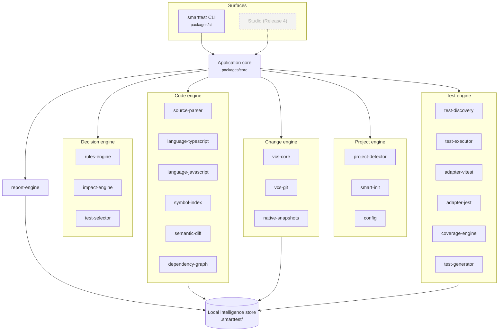
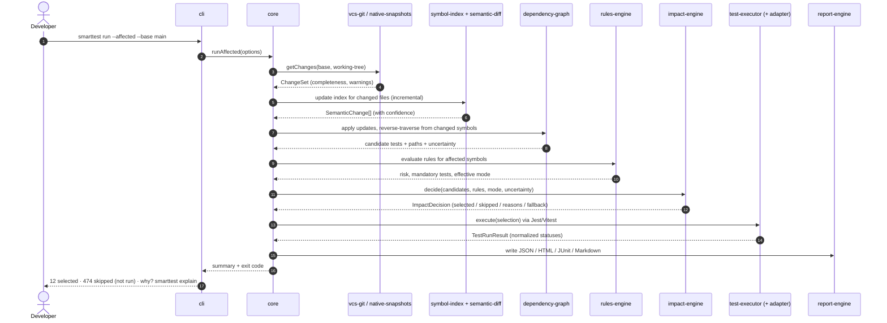

# Architecture overview

> SmartTest is an intelligent layer **on top of** existing test runners. It works out what changed, what depends on it and which tests protect it, then lets Jest or Vitest do the running.

This document describes the **v1.0.0** architecture. The full long-term architecture (AI, Studio, Cloud) is in [PRD §4](../product/PRD.md#4-system-architecture). Decisions are recorded in [ADRs](adr/README.md).

## Layers



**Rules of the road**

1. **Dependencies point inwards.** `shared` → contracts → engines → `core` → `cli`. The manifest (`scripts/packages.manifest.json`) is the source of truth and the scaffolder rejects cycles.
2. **The core is deterministic and local.** Nothing in `core` or below may make network calls or depend on `ai-*` packages ([ADR-0004](adr/0004-deterministic-core-ai-optional.md)).
3. **Adapters declare capabilities.** Anything not declared counts as unsupported and is never emulated ([ADR-0005](adr/0005-capability-declared-adapters.md)).
4. **Uncertainty is data.** Unresolved imports, dynamic patterns and partial change sets are stored and passed along. They never get dropped.

## The `run --affected` data flow



## Package map (v1.0.0)

| Package                                          | Responsibility                                                     | Epic |
| ------------------------------------------------ | ------------------------------------------------------------------ | ---- |
| `@smarttest/shared`                              | Contracts from the spec, primitives, `SmartTestError`, exit codes  | FND  |
| `@smarttest/config`                              | `defineConfig`, schema, loader, validation                         | FND  |
| `@smarttest/plugin-sdk`                          | Public adapter contracts + conformance kit                         | FND  |
| `@smarttest/project-detector`                    | Runtime, package manager, workspaces, frameworks, runners, VCS, CI | DET  |
| `@smarttest/smart-init`                          | Recommendation engine, plan, safe writes, journal, rollback        | INI  |
| `@smarttest/vcs-core`                            | `VersionControlAdapter`, `ChangeSet` utilities                     | VCS  |
| `@smarttest/vcs-git`                             | Git adapter                                                        | VCS  |
| `@smarttest/native-snapshots`                    | Snapshots, fingerprints, comparisons                               | VCS  |
| `@smarttest/source-parser`                       | Language-neutral parse pipeline & cache                            | SRC  |
| `@smarttest/language-typescript` / `-javascript` | Language adapters                                                  | SRC  |
| `@smarttest/symbol-index`                        | Persistent incremental symbol index                                | SRC  |
| `@smarttest/semantic-diff`                       | Change classification with confidence                              | SRC  |
| `@smarttest/dependency-graph`                    | Graph model, storage, traversal, queries                           | GRA  |
| `@smarttest/rules-engine`                        | Rule evaluation, precedence, explanations                          | RUL  |
| `@smarttest/impact-engine`                       | Modes, mandatory triggers, fallbacks, decisions                    | IMP  |
| `@smarttest/test-selector`                       | Decision → runnable selection                                      | IMP  |
| `@smarttest/test-discovery`                      | Normalized discovery                                               | EXE  |
| `@smarttest/test-executor`                       | Scheduling, timeouts, cancellation, retries                        | EXE  |
| `@smarttest/adapter-vitest` / `adapter-jest`     | Runner adapters                                                    | EXE  |
| `@smarttest/coverage-engine`                     | Coverage ingestion with scope                                      | REP  |
| `@smarttest/test-generator`                      | Layouts, templates, scaffolds, sync                                | GEN  |
| `@smarttest/report-engine`                       | JSON / HTML / JUnit / Markdown + integrity                         | REP  |
| `@smarttest/core`                                | Orchestration API used by CLI (and later Studio)                   | FND  |
| `smarttest`                                      | The CLI (`bin: smarttest`)                                         | CLI  |

## Local intelligence store

```text
.smarttest/                    (git-ignored, path configurable via storeDir)
├── state/
│   ├── index.json             per-file analyses (content-hash cached), file stats, resolution context
│   ├── snapshots/             snapshot manifests (hashes; content optional)
│   ├── blobs/                 deduplicated gzip content (when snapshots.storeContent)
│   └── init-journal.json      what init changed → rollback
├── runs/                      latest.json, <runId>.json, last-decision.json, coverage.json, flaky.json
├── reports/                   report.html · report.json · junit.xml · summary.md · setup.md
├── coverage/                  raw coverage per runner root
└── logs/                      smarttest.log (JSON, redacted, rotated at 1 MB)
```

See [ADR-0003](adr/0003-local-store-sqlite.md) for why this is a JSON store and not SQLite in 1.0.

## Distribution

Internal `@smarttest/*` packages are private. `scripts/release/bundle-cli.mjs` bundles the CLI and every engine into one ESM package, `smarttest`, with `typescript` as its only runtime dependency. The engine is loaded lazily, so `--help` and `--version` start in under 100 ms.

## Where the spec contracts live

The TypeScript contracts from the spec (`ChangeSet`, `SourceSymbol`, `ImpactDecision`, `TraceRecord`, `TestAdapter`, `LanguageAdapter`, `VersionControlAdapter`) are in [`packages/shared/src/contracts`](../../packages/shared/src/contracts) for Sprint 0. They will move to their owning packages once their APIs stabilise ([ADR-0006](adr/0006-contracts-first.md)).
