# How test selection works

SmartTest answers one question per change: which tests could detect a regression caused by this change, and how sure are we?

<p align="center"></p>

## 1. Changes

A provider (Git, native snapshots, or both) produces a normalized ChangeSet: added, modified, deleted and renamed files, plus changed line ranges and a `completeness` flag. → [Change tracking](change-tracking.md)

## 2. Semantic diff

Changed ranges are mapped to symbols and classified as comment-only, formatting, implementation, signature, exported API, interface, inheritance, decorator, import, configuration, potential-behavioral or unclassifiable. Every classification carries a confidence. If SmartTest can't tell, the change is unclassifiable. It is never treated as a no-op.

## 3. Dependency graph

The graph holds files, symbols, tests and configuration. Its edges are `IMPORTS`, `CALLS`, `EXTENDS`, `INSTANTIATES`, `TESTS` and others, each with provenance (static, rule, …) and confidence. Starting from the changed symbols, SmartTest walks reverse edges to find every test that can reach them, and keeps the path as evidence.

<p align="center"></p>

### What counts as a dependency

- Files: in a Git repository, the project is what `git ls-files` sees. Everything `.gitignore` excludes (build output such as `.wasp/`, `.next/`, `dist/`) and submodules are skipped.
- Tests: each runner (Jest, Vitest, `node --test`) is asked which files it collects, with its own config. A file named `*.test.ts` that no runner collects never runs, and `doctor` reports it.
- Computed imports: ``import(`${SCRIPTS}x.mjs`)``, `new URL("../tpl/", import.meta.url)` and `resolve(__dirname, "fixtures")` are evaluated statically. A partially known path becomes a bounded glob (`templates/*.ts`). Only truly unknowable imports (`import(file)`) remain uncertainty.

## 4. Rules & safety

[Rules](rules.md) add risk levels, always-run tests and mode overrides. Mandatory triggers widen the selection for changes with global impact:

| Trigger                                                  | Default effect                               |
| -------------------------------------------------------- | -------------------------------------------- |
| `tsconfig*.json`, Babel/SWC config                       | full suite                                   |
| Jest/Vitest config, global setup files                   | full suite for that runner/project           |
| `package.json` dependencies, lockfiles                   | full suite (affected workspace in monorepos) |
| `.env*` templates, shared env config                     | full suite                                   |
| Unresolved import or dynamic pattern touching the change | widened per mode, see below                  |

Rules can add triggers but cannot remove the built-in ones.

## 5. Modes

|                                                 | FAST                     | BALANCED (default)                 | SAFE                    |
| ----------------------------------------------- | ------------------------ | ---------------------------------- | ----------------------- |
| Intended for                                    | local loop               | pull requests                      | releases, critical code |
| Traversal                                       | full transitive          | full transitive                    | full transitive         |
| Comment/format-only changes                     | skipped (with a warning) | treated as changes                 | treated as changes      |
| Tests that depend on unresolved/dynamic imports | warning only             | selected ("cannot be ruled out")   | selected                |
| Incomplete change set (e.g. hash-only snapshot) | whole-file seeds         | whole-file seeds, status `partial` | full suite              |
| Critical-risk rules                             | upgrade to SAFE          | upgrade to SAFE                    | SAFE                    |

Rules can only make the effective mode stricter. The decision always records the requested and the effective mode.

## 6. Decision & fallback

The result is an `ImpactDecision` containing selected tests with reasons, skipped tests with reasons, `analysisStatus` (`complete | partial | fallback`), `fallbackApplied` and any warnings. When the analysis is incomplete in a way that matters, SmartTest widens the selection or runs everything, and tells you why.

## 7. Run & report

Selected tests run through the project's runner (Jest, Vitest or `node --test`). Results are normalized, and skipped tests are reported as not run, never as passed. → [Safety model](safety-model.md)

## Asking "why?"

```text
$ smarttest explain test/routes/protected.test.ts

SELECTED  test/routes/protected.test.ts
Reasons
  • Modified symbol: AuthService.validateToken (implementation, high confidence)
  • Transitive dependency: validateToken → AuthenticationMiddleware → protected.test.ts
  • Matched rule: authentication-critical (risk: critical → mode SAFE)
Analysis: complete · mode: balanced
```

```text
$ smarttest explain src/catalog/CatalogService.test.ts

SKIPPED (not run)  src/catalog/CatalogService.test.ts
Reasons
  • No static dependency path from changed symbols
  • No mandatory trigger matched · no rule requires it
Confidence
  Limited to the analysed dependency model (0 unresolved imports in the affected area)
```
