# How test selection works

SmartTest answers one question per change: which tests could detect a regression caused by this change, and how sure are we?

<p align="center"></p>

## 1. Changes

A provider (Git, native snapshots, or both) produces a normalized ChangeSet: added, modified, deleted and renamed files, plus changed line ranges and a `completeness` flag. → [Change tracking](change-tracking.md)

## 2. Semantic diff

Changed ranges are mapped to symbols and classified as comment-only, formatting, implementation, signature, exported API, interface, inheritance, decorator, import, configuration, potential-behavioral or unclassifiable. Every classification carries a confidence. If SmartTest can't tell, the change is unclassifiable. It is never treated as a no-op.

## 3. Dependency graph

The graph holds files, symbols, tests and configuration. Its edges are `IMPORTS`, `CALLS`, `EXTENDS`, `INSTANTIATES`, `TESTS` and others, each with provenance (static, rule, …) and confidence. Starting from the changed symbols, SmartTest walks reverse edges to find every test that can reach them, and keeps the path as evidence.

<p align="center"></p>

### What counts as a dependency

- Files: in a Git repository, the project is what `git ls-files` sees. Everything `.gitignore` excludes (build output such as `.wasp/`, `.next/`, `dist/`) and submodules are skipped.
- Tests: each runner (Jest, Vitest, `node --test`) is asked which files it collects, with its own config. A file named `*.test.ts` that no runner collects never runs, and `doctor` reports it.
- Computed imports: ``import(`${SCRIPTS}x.mjs`)``, `new URL("../tpl/", import.meta.url)` and `resolve(__dirname, "fixtures")` are evaluated statically. A partially known path becomes a bounded glob (`templates/*.ts`). Only truly unknowable imports (`import(file)`) remain uncertainty.
- `import.meta.glob` (and Vite 2's `globEager`): relative, root-absolute (`/src/pages/*.ts`, from the nearest Vite root) and aliased patterns, alone or in an array, with or without `{ eager: true }`. A negated pattern (`!**/*.test.ts`) is ignored, which keeps more files, never fewer.
- Aliases: tsconfig/jsconfig `paths`, and aliases that only a bundler or test-runner config declares: Vite and Vitest `resolve.alias`/`test.alias` (object and `{ find, replacement }` forms, regex finds), Jest `moduleNameMapper` (`$1` captures, `<rootDir>`, directory targets, lists of targets; also in package.json), webpack `resolve.alias` (`name$` for the exact name) and Babel `module-resolver` `alias`. The nearest config of each tool applies, with the local modules it imports. When two configs (the app's Vite alias and the tests' Jest mapper) map an import to different files, the import stays uncertain; an alias whose value is computed (`alias: makeAliases()`) leaves its imports unresolved. These configs are resolution inputs: editing one re-resolves the imports.

### Member-level precision

Methods and accessors are units of their own. `this.tokens.verify()` is linked to `TokenManager.verify` when the class of `this.tokens` is known locally (`new X()`, `x: X`, constructor parameter properties). A change to `verify` then reaches only callers of `verify`, not every user of `TokenManager`. Values that leave a function (returned, passed, stored) or whose class cannot be inferred are linked to the whole class. Constructor, field and heritage changes affect the whole class. Inherited members resolve to the base class; `super.m()` to the base member.

Code that runs when a module is loaded affects every importer, in every mode: a change to it selects all the tests that import the file, directly or transitively, whatever names they use. That covers top-level statements, side-effect imports, and declarations whose evaluation can run code: an initializer that calls or constructs anything (`export const X = make()`, an IIFE, `await`), class decorators, static fields and static blocks, enums with computed members and namespaces with runtime code. Adding, changing or removing such a declaration counts, even when no test uses its name (a new `export const X = (() => { throw … })()` fails every importer at import). Only declarations that cannot run code at load stay member-level: functions, classes without decorators or static initializers, and initializers that are literals, arrow or function expressions, or object and array literals of those.

### Barrels and re-exports

An import from a barrel (`import { price } from "./shop"`, where `shop/index.ts` re-exports other modules) is linked to the symbol it names, through any depth of barrels: `export *`, `export { total as cartTotal } from`, `export { default as greet } from`, `export * as format from` and `import * as ns from "./x"; export { ns }`. A change to `price` selects the importers of `price`, not every importer of the barrel. A namespace read member by member (`format.money()`, `ns.price()`) is linked to those members.

A barrel whose change only adds, removes, renames or repoints named re-exports (`export { a, b as c } from "./x"`), and that loads the same modules before and after, selects the importers of the names that changed. Everything else about a barrel stays conservative and selects every importer of the barrel, directly or through other barrels:

- A module newly loaded or no longer loaded by the barrel (a new `export … from "./y"`, a removed one): loading a module runs its code.
- A change to an `export *` list or to a namespace re-export: which names it carries is the graph's to say, not the diff's.
- Code that runs when the barrel or a module behind it loads (a top-level loop over the re-exports, a registry): see above.
- An importer the analysis cannot pin to a name: a member read by a computed name (`ns[name]`), a namespace that is passed on (`Object.keys(ns)`, `fn(ns)`), a side-effect import (`import "./shop"`), a name that resolves to no project module (an `export *` from a package). Any change behind the barrel selects these importers.
- CommonJS barrels (`module.exports = { ...require("./a") }`, `module.exports = require("./a")`): the names they carry are not read, so every importer is selected.

### Resources and conventions

Some changes are not code. SmartTest links them to the code that reads them:

| Change                                                                      | Selected                                                                                                                                                                                                  |
| --------------------------------------------------------------------------- | --------------------------------------------------------------------------------------------------------------------------------------------------------------------------------------------------------- |
| A key in `.env*`                                                            | Code reading `process.env.KEY` or `import.meta.env.KEY` (or the whole environment). A key no code reads keeps the mandatory trigger                                                                       |
| A model or enum in `*.prisma`                                               | Code using `prisma.model`, `db.model`, `context.entities.Model` or the model type. Datasource/generator changes widen to the schema's directory                                                           |
| A key in a translation catalog                                              | Code calling `t("key")` in that namespace. Parent objects, plural variants and template keys such as ``t(`menu.${id}`)`` match; `t(variable)` reads any key of its namespace. Tests importing the catalog |
| A file read through `fs` with a path built from `__dirname` / `import.meta` | The function that reads it                                                                                                                                                                                |
| `__snapshots__/x.test.ts.snap`                                              | `x.test.ts`                                                                                                                                                                                               |
| `__mocks__/m.ts`                                                            | Users of `m`                                                                                                                                                                                              |
| A generator input listed in `generated[].from`                              | Tests of the generated outputs, with a regenerate warning                                                                                                                                                 |

Translation keys are qualified by the namespace bound with `useTranslation("ns")` (per binding, so `const { t: tl } = useTranslation("landing")` reads `landing` keys). A translation function received as a parameter, as in `getNav(t)`, reads in its callers' namespaces: the caller records that it passes `t` on.

### End-to-end specs

Playwright and Cypress specs rarely import application code; they visit URLs. SmartTest reads the visits (`page.goto("/users")`, ``request.get(`/users/${id}`)``, `cy.visit("/about")`) and links each URL to the files that serve it. Next.js conventions are understood: `app/**/page.*` and `route.*` (route groups, `[param]`, `[...slug]`), `pages/**`, and layouts, `_app`, `_document` and `middleware` for every route below them. A change to a page, or to anything it imports, selects the specs that visit it. A spec whose visits cannot all be matched (a URL built at run time, a route SmartTest does not know) is uncertain, so it is never ruled out in BALANCED or SAFE mode.

A test that replaces module M with a factory mock (`vi.mock("./m", () => …)`, `jest.mock` with a factory that does not load the original) never runs M. Implementation changes in M, or in modules only reached through M, do not select it. A change to what M exports still does.

## 4. Rules & safety

[Rules](rules.md) add risk levels, always-run tests and mode overrides. Mandatory triggers widen the selection for changes with global impact:

| Trigger                                                  | Default effect                                                                                                                             |
| -------------------------------------------------------- | ------------------------------------------------------------------------------------------------------------------------------------------ |
| `tsconfig*.json`, Babel/SWC config                       | full suite                                                                                                                                 |
| A runner's config and the local files it imports         | every test of that runner                                                                                                                  |
| Files the config names, and everything they import       | every test of that runner (setup files, global setup/teardown, test environment, Cypress support file, `node --test --import`/`--require`) |
| A local file an alias / `moduleNameMapper` maps to       | tests that import the mapped specifier (every test of the runner when none is analysed, e.g. stylesheets)                                  |
| PostCSS/Tailwind config, `.babelrc`, setup-named files   | full suite for their directory                                                                                                             |
| `package.json` dependencies, lockfiles                   | the code importing the packages that changed (see below); the full suite (affected workspace in monorepos) when that cannot be told apart  |
| `.env`, `.env.test`, `.env.local`…                       | full suite, unless every changed key is read by analysed code (then its readers)                                                           |
| Unresolved import or dynamic pattern touching the change | widened per mode, see below                                                                                                                |

The config is read statically. When a setting that names files is computed (`setupFiles: findSetups()`), SmartTest says so in a warning, selects every test of that runner for a changed file no test imports, and never caches that runner's results. `smarttest explain test/setup.ts` lists the runners that load a file and why ("setup file of vitest (setupFiles in vitest.config.ts)").

Lockfiles (`package-lock.json`, `pnpm-lock.yaml`, `yarn.lock`, Classic and Berry) and `package.json` are read by package. The packages whose resolved entry changed, and every package depending on them up to the ones the project declares, select the code that imports them, and an `@types/x` package the code importing `x`. A dependency bump then runs the tests that use that package, not the whole suite. Everything is still selected when SmartTest cannot tell that apart safely, and the trigger's reason says which case it is:

- a test or build tool changed, or anything it depends on (Vitest, Jest, Vite, esbuild, Babel, TypeScript, the Angular CLI and builders, Playwright, Cypress, jsdom…); a builder an Angular workspace's test targets do not use, such as `@angular-devkit/build-angular` beside `@angular/build:unit-test`, does not count;
- a declared package no analysed file imports (a runner plugin, a CLI a script runs, a type package), except lint, format and commit tools (ESLint, Prettier, Husky, lint-staged…);
- a runner's config or setup file imports it, or a config or stylesheet names it (`preset: "ts-jest"`, `@use "bootstrap/…"`);
- a lockfile setting changed (its version, `settings`, `overrides`, Yarn's `__metadata`), the lockfile cannot be read, or it was added or deleted;
- any `package.json` field other than the dependency lists and metadata changed (`scripts`, `type`, `exports`, a `jest` section…).

A file with an import SmartTest cannot evaluate (`require(name)`) may load any package: it is selected with every lockfile change.

Rules can add triggers but cannot remove the built-in ones.

### Computed imports and reads

A computed path SmartTest can evaluate is an edge: string constants, `+` and template literals, `__dirname`, `import.meta.url`, `new URL(…, import.meta.url)`, `join`/`resolve`, and `process.cwd()` (taken to be one of the directories above the file). A part it cannot evaluate matches any file at any depth below the known part, so `resolve(process.cwd(), "public", AVATAR.slice(1))` reads anything under `public/`. A path written with the compiled extension (`new Worker(new URL("./worker.js", import.meta.url))`) finds the `.ts` source. A file that lists a directory (`readdirSync`) reads everything below the folders it names from its own location.

Anything else is uncertainty. When the author knows what a computed import loads (a config loader, a plugin loader), a comment says so, relative to the project root, and those files become its dependencies:

```ts
// smarttest-loads: plugins/*.mjs, config/*.mjs
const mod = await import(pathToFileURL(file).href);
```

The comment is on the import's line or the line above; it replaces the uncertainty, so name every place the import can load from.

## 5. Observed execution

When `smarttest trace` has recorded which functions each test ran, a fresh trace can rule out a test that static analysis reaches but that never ran the changed code, and can add a test static analysis missed. SAFE mode only adds. → [Runtime evidence](runtime-evidence.md)

## 6. Modes

|                                                 | FAST                     | BALANCED (default)                 | SAFE                    |
| ----------------------------------------------- | ------------------------ | ---------------------------------- | ----------------------- |
| Intended for                                    | local loop               | pull requests                      | releases, critical code |
| Traversal                                       | full transitive          | full transitive                    | full transitive         |
| Comment/format-only changes                     | skipped (with a warning) | treated as changes                 | treated as changes      |
| Tests that depend on unresolved/dynamic imports | warning only             | selected ("cannot be ruled out")   | selected                |
| Incomplete change set (e.g. hash-only snapshot) | whole-file seeds         | whole-file seeds, status `partial` | full suite              |
| Critical-risk rules                             | upgrade to SAFE          | upgrade to SAFE                    | SAFE                    |
| Fresh runtime traces                            | rule out and add         | rule out and add                   | add only                |

Rules can only make the effective mode stricter. The decision always records the requested and the effective mode.

## 7. Decision & fallback

The result is an `ImpactDecision` containing selected tests with reasons, skipped tests with reasons, `analysisStatus` (`complete | partial | fallback`), `fallbackApplied` and any warnings. Its details also list the dependencies the change adds or removes, tests ruled out by traces, and changed units no test reaches ("unprotected"). When a project's whole suite ran faster last time than an analysis usually takes, `run` skips the graph and runs everything ("Adaptive" in the reasons; `adaptive: false` turns this off). When the analysis is incomplete in a way that matters, SmartTest widens the selection or runs everything, and tells you why.

## 8. Run & report

Selected tests run through the project's runner (Jest, Vitest or `node --test`). Results are normalized, and skipped tests are reported as not run, never as passed. → [Safety model](safety-model.md)

The runner is started the way the project's own script starts it:

- `node --test`: the first package.json script that runs `node … --test` gives its node options and the variables set before `node` (`NODE_OPTIONS=…`, `TZ=UTC`, also after `cross-env`). Passed: `--import`, `--require`/`-r`, `--loader`, `--env-file`, `--conditions`/`-C`, `--experimental-*`, `--test-concurrency`, `--test-timeout`, `--test-isolation` and any other node option. Not passed: the script's file and glob arguments (SmartTest gives the selected files), `--test-name-pattern`, `--test-skip-pattern`, `--test-only`, `--test-reporter`, `--test-reporter-destination`, `--test-shard`, `--watch`, coverage options (`--experimental-test-coverage`, `--test-coverage-*`), `--test-update-snapshots` and the inspector. `--workers` replaces the script's `--test-concurrency`. A part built at run time (`$VAR`, a subshell) is left out.
- Vitest: a script that runs Vitest with `--typecheck` (or `--typecheck.enabled`) for the same config makes discovery and runs pass `--typecheck`, so type tests (`*.test-d.ts`) are listed and run. `--typecheck.only` is not followed (it would drop the runtime tests).
- Playwright: each selected spec is passed as a filter anchored on its whole path, so `home.spec.ts` never also runs `myhome.spec.ts` or `e2e/home.spec.ts`.

## Asking "why?"

Output from the `nest-auth-vitest` fixture after a change to `TokenManager.verify`:

```text
$ smarttest impact
◇ git · HEAD…working tree · 1 changed file(s) · mode balanced · analysis complete
  modified src/modules/auth/TokenManager.ts  implementation

  [SELECTED]  3
  ■ test/routes/ProtectedRoutes.test.ts  Transitively depends on src/modules/auth/TokenManager.ts#TokenManager.verify (4 hops)
  ■ tests/unit/modules/auth/AuthService.test.ts  Transitively depends on src/modules/auth/TokenManager.ts#TokenManager.verify (2 hops)
  ■ tests/unit/modules/auth/TokenManager.test.ts  Directly depends on src/modules/auth/TokenManager.ts#TokenManager.verify
  [SKIPPED]   4 · not run
```

```text
$ smarttest explain test/routes/ProtectedRoutes.test.ts
[SELECTED]  test/routes/ProtectedRoutes.test.ts
Reasons
  • Transitively depends on src/modules/auth/TokenManager.ts#TokenManager.verify (4 hops)
  src/modules/auth/TokenManager.ts#TokenManager.verify → src/modules/auth/AuthService.ts#AuthService.validateToken → src/modules/auth/AuthenticationMiddleware.ts#authenticate → src/routes/protected.ts#protectedRoute → test/routes/ProtectedRoutes.test.ts
Analysis: complete · mode: balanced · git · HEAD…working tree
```

```text
$ smarttest explain tests/unit/modules/auth/AuthController.test.ts
[SKIPPED (not run)]  tests/unit/modules/auth/AuthController.test.ts
Reasons
  • No static dependency path from changed code
  • No mandatory trigger matched
  • No rule requires it
Confidence
  Limited to the analysed dependency model (0 file(s) with unresolved imports in its dependencies)
```

`AuthController` uses `TokenManager.issue`, not `verify`, so it is skipped.
