# Getting started

## Requirements

- Node.js 22.12 or newer
- A JavaScript or TypeScript project that uses Jest, Vitest or `node --test` (several runners and several projects in one repository are fine)
- Git is optional; without it SmartTest uses local snapshots

## Install

SmartTest is not on npm yet. Build the package from this repository and install the tarball:

```bash
git clone https://github.com/RemiPelloux/SmarttyTest && cd SmarttyTest
corepack enable && pnpm install && pnpm build && pnpm release:pack
# in your project:
npm install -D /path/to/SmarttyTest/packages/cli/.publish/smarttest-0.6.0.tgz
```

If your repository has no root `package.json` (several independent projects), add a minimal one for repository tooling, as LeadsIt does.

## Set up

```bash
npx smarttest init --dry-run    # print the plan and the diff of every file
npx smarttest init --yes        # apply it
```

Example output on a repository with three runners:

```text
Detected: Wasp + React + Express + Prisma + TypeScript + Vitest + Jest + node:test · npm · 6 independent projects · Git

Recommended
  Test layout      colocated                  (63% of existing tests follow this convention)
  Adapter          vitest, jest, node         (existing runner configuration is reused as-is)
  Impact mode      balanced
  Skipped tests    backend/**/*redisJobQueue* (your existing test commands skip these, so SmartTest does too)
  Git hook         smarttest run --staged     (.husky/pre-commit runs 3 full suite(s); one affected-tests run can replace them)

Changes
  + smarttest.config.ts   SmartTest configuration
  ~ .gitignore            ignore local SmartTest state
```

Running `init` again changes nothing. `npx smarttest init --rollback` restores the files it changed, unless you edited them since.

## Run

```bash
npx smarttest run                  # affected by uncommitted changes
npx smarttest run --staged         # affected by staged changes, for a pre-commit hook
npx smarttest run --base main      # affected by the current branch
npx smarttest run --all            # everything
```

<p align="center"></p>

## Check the selection

```bash
npx smarttest explain <test>          # why it ran or not
npx smarttest explain <file>          # which tests cover a file
npx smarttest validate-selection      # run selection and full suite, compare
npx smarttest benchmark --commits 20  # replay history: full run vs SmartTest, misses re-checked
npx smarttest shadow                  # full suite next to the selection, recorded over time
npx smarttest graph why <from> <to>   # shortest dependency path between two places
npx smarttest doctor                  # runners, discovery, index, configuration
```

## Record what each test runs (optional)

```bash
npx smarttest trace           # runs each test file once with V8 coverage (about one full run)
npx smarttest trace --status  # how many traces are still fresh
npx smarttest trace --stale   # refresh only the stale ones
```

With fresh traces, a test that can reach a change on paper but never ran the changed code is skipped in FAST and BALANCED mode. See [runtime evidence](../concepts/runtime-evidence.md).

## Use it in a Git hook

`init` plans this for you. To do it separately:

```bash
npx smarttest hook status             # which hook manager, and which steps run whole suites
npx smarttest hook install --replace  # add SmartTest, comment out the full-suite steps
npx smarttest hook uninstall          # remove it and restore those steps
```

It works with husky, lefthook, simple-git-hooks and plain `.git/hooks`. The hook runs `npx --no-install smarttest run --staged --non-interactive`.

## Use it in CI

```bash
npx smarttest ci                      # picks the base for merge requests and branch builds
```

## Reports and generated tests

```bash
npx smarttest report --open           # HTML report of the last run
npx smarttest generate --dry-run      # missing test files as it.todo scaffolds
```

Next: [how selection works](../concepts/how-selection-works.md), [runtime evidence](../concepts/runtime-evidence.md), [CLI reference](../reference/cli.md), [configuration](../reference/configuration.md), [running in CI](ci.md).
