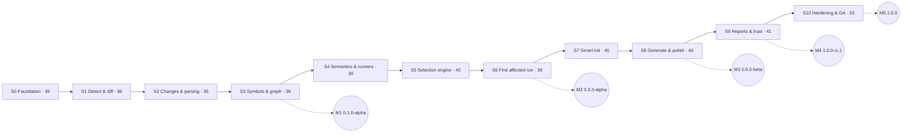

# Roadmap

| Release       | Version            | Theme                                                                                                                                          | Status                                                                             |
| ------------- | ------------------ | ---------------------------------------------------------------------------------------------------------------------------------------------- | ---------------------------------------------------------------------------------- |
| Release 0 + 1 | **1.0.0 "Impact"** | Foundation + intelligent npm MVP: Smart Init, Git + snapshots, TS/JS analysis, graph, impact selection, rules, Jest/Vitest, generator, reports | **In progress · v0.2.0 · 389 / 422 pts done** → [charter](release-1.0.0/README.md) |
| 1.1.0         | Adopt              | npm, hooks, CI templates, per-project conventions, TS 7 readiness · 120 pts                                                                    | Planned → [roadmap 1.x](roadmap-1.x.md)                                            |
| 1.2.0         | Adapt              | `sync`/`migrate`, watch mode, Playwright/Cypress, SVN · 120 pts                                                                                | Planned                                                                            |
| 1.3.0         | Observe            | per-test tracing, diff coverage, Shadow Mode, flaky analytics · 160 pts                                                                        | Planned                                                                            |
| 1.4.0         | Accelerate         | validated result cache, sharding, duration-aware scheduling · 120 pts                                                                          | Planned                                                                            |
| 1.5.0         | See                | Studio preview, VS Code extension, Plugin SDK 1.0 · 160 pts                                                                                    | Planned                                                                            |
| Release 3     | 2.0.0              | AI test engineering, optional: provider manager, generation, audit, repair, review                                                             | Backlog                                                                            |
| Release 5     | —                  | SmartTest Cloud: team analytics, PR intelligence, shared cache, billing                                                                        | Backlog                                                                            |
| Release 6     | —                  | Multi-language: Python, Java, Go; more VCS; cross-language analysis                                                                            | Backlog                                                                            |

The sequence follows [PRD §35](../product/PRD.md#35-release-roadmap). It is re-evaluated at each milestone using benchmark results and feedback from design partners.

