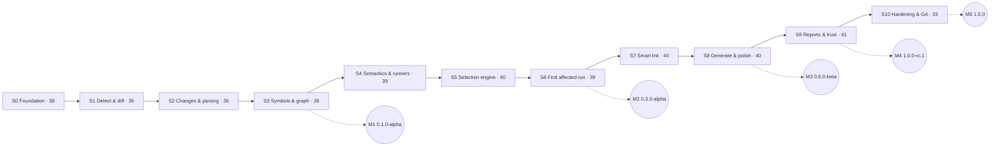

# Roadmap

| Release       | Version            | Theme                                                                                                                                          | Status                                                                                   |
| ------------- | ------------------ | ---------------------------------------------------------------------------------------------------------------------------------------------- | ---------------------------------------------------------------------------------------- |
| Release 0 + 1 | **1.0.0 "Impact"** | Foundation + intelligent npm MVP: Smart Init, Git + snapshots, TS/JS analysis, graph, impact selection, rules, Jest/Vitest, generator, reports | **In progress · v0.1.0 alpha · 389 / 422 pts done** → [charter](release-1.0.0/README.md) |
| Release 2     | 1.x                | Advanced intelligence: adaptive config/`sync`, SVN, runtime tracing, diff coverage, result cache, watch mode, Shadow Mode                      | Backlog                                                                                  |
| Release 3     | 2.0 (tentative)    | AI test engineering, optional: provider manager, generation, audit, repair, review                                                             | Backlog                                                                                  |
| Release 4     | —                  | SmartTest Studio: local web GUI                                                                                                                | Backlog                                                                                  |
| Release 5     | —                  | SmartTest Cloud: team analytics, PR intelligence, shared cache, billing                                                                        | Backlog                                                                                  |
| Release 6     | —                  | Multi-language: Python, Java, Go; more VCS; cross-language analysis                                                                            | Backlog                                                                                  |

The sequence follows [PRD §35](../product/PRD.md#35-release-roadmap). It is re-evaluated at each milestone using benchmark results and feedback from design partners.

