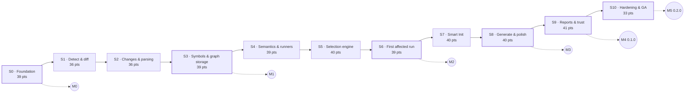

<!-- GENERATED by scripts/planning/generate-backlog.mjs from backlog.data.mjs — do not edit by hand. -->

# Foundation backlog (shipped in 0.1.0 and 0.2.0): sprints

Planning is in **story points only**. Capacity per sprint: **40 pts** (hard cap 42). Re-baseline at every sprint review using measured velocity.

**Implementation (v0.2.0):** 386 / 422 committed points done.

## Overview

| Sprint | Name | Points | Load vs capacity | Done | Milestone |
|---|---|---|---|---|---|
| [S0](#s0--foundation) | Foundation | 39 / 40 | `██████████░` | 30 pts | **M0** Foundation ready |
| [S1](#s1--detect--diff) | Detect & diff | 36 / 40 | `█████████░░` | 36 pts |  |
| [S2](#s2--changes--parsing) | Changes & parsing | 36 / 40 | `█████████░░` | 36 pts |  |
| [S3](#s3--symbols--graph-storage) | Symbols & graph storage | 39 / 40 | `██████████░` | 39 pts | **M1** Change intelligence |
| [S4](#s4--semantics--runners) | Semantics & runners | 39 / 40 | `██████████░` | 39 pts |  |
| [S5](#s5--selection-engine) | Selection engine | 40 / 40 | `██████████░` | 32 pts |  |
| [S6](#s6--first-affected-run) | First affected run | 39 / 40 | `██████████░` | 36 pts | **M2** First affected run |
| [S7](#s7--smart-init) | Smart Init | 40 / 40 | `██████████░` | 40 pts |  |
| [S8](#s8--generate--polish) | Generate & polish | 40 / 40 | `██████████░` | 40 pts | **M3** Init & generate |
| [S9](#s9--reports--trust) | Reports & trust | 41 / 40 | `██████████░` | 41 pts | **M4** `0.1.0` First release |
| [S10](#s10--hardening--ga) | Hardening & GA | 33 / 40 | `████████░░░` | 17 pts | **M5** `0.2.0` Real-world validation (LeadsIt) |

## Burn-up (points)

| After sprint | Cumulative points | % of committed scope |
|---|---|---|
| S0 | 39 | 9% |
| S1 | 75 | 18% |
| S2 | 111 | 26% |
| S3 | 150 | 36% |
| S4 | 189 | 45% |
| S5 | 229 | 54% |
| S6 | 268 | 64% |
| S7 | 308 | 73% |
| S8 | 348 | 82% |
| S9 | 389 | 92% |
| S10 | 422 | 100% |

## Milestones

### M0 — Foundation ready

End of S0 · 39 / 422 pts delivered

- [ ] `pnpm verify` green
- [ ] ADR-0001…0007 written
- [ ] Fixture catalogue committed

### M1 — Change intelligence

End of S3 · 150 / 422 pts delivered

- [ ] `scan`, `vcs status`, `snapshot diff` work on all fixtures
- [ ] Persisted index for every TS/JS fixture

### M2 — First affected run

End of S6 · 268 / 422 pts delivered

- [ ] `run --affected` + `explain` end-to-end on Jest and Vitest fixtures
- [ ] Regression harness: 0 missed known failures

### M3 — Init & generate

End of S8 · 348 / 422 pts delivered

- [ ] `init` idempotent and reversible on all fixtures
- [ ] `generate` never overwrites user files

### M4 — First release (`0.1.0`)

End of S9 · 389 / 422 pts delivered

- [ ] Reports, `validate-selection`, benchmarks
- [ ] Report integrity suite green

### M5 — Real-world validation (LeadsIt) (`0.2.0`)

End of S10 · 422 / 422 pts delivered

- [ ] LeadsIt pre-commit hook runs SmartTest
- [ ] 706/706 parity with native runners
- [ ] History benchmark: 0 missed failures

---

## S0 — Foundation

**39 / 40 pts committed**

**Sprint goal:** Everyone can build, test and lint every package; contracts, fixtures, error model and ADRs are in place; the two big technical bets are de-risked by spikes.

**Demo:** Fresh clone → `pnpm i && pnpm verify` green on Linux/macOS/Windows; walk through ADRs and the fixture catalogue.

| ID | Epic | Story | Pri | Pts | Status |
|---|---|---|---|---|---|
| [ST-001](epics/FND-core-project-foundation.md#st-001) | FND | Initialize the TypeScript monorepo | Must | 3 | done |
| [ST-002](epics/FND-core-project-foundation.md#st-002) | FND | Define and enforce package boundaries | Must | 3 | done |
| [ST-003](epics/FND-core-project-foundation.md#st-003) | FND | Configuration contract, loader and schema validation | Must | 5 | done |
| [ST-004](epics/FND-core-project-foundation.md#st-004) | FND | Linting, formatting and strict typing gates | Must | 2 | done |
| [ST-005](epics/FND-core-project-foundation.md#st-005) | FND | Fixture project catalogue | Must | 5 | partial |
| [ST-006](epics/FND-core-project-foundation.md#st-006) | FND | Continuous integration pipeline | Must | 3 | changed |
| [ST-007](epics/FND-core-project-foundation.md#st-007) | FND | Structured logging with secret redaction | Must | 3 | done |
| [ST-008](epics/FND-core-project-foundation.md#st-008) | FND | Stable error model and exit codes | Must | 2 | done |
| [ST-009](epics/FND-core-project-foundation.md#st-009) | FND | Plugin SDK foundation and capability model | Must | 5 | done |
| [ST-010](epics/FND-core-project-foundation.md#st-010) | FND | Architecture documentation and ADRs | Must | 2 | done |
| [ST-011](epics/FND-core-project-foundation.md#st-011) | FND | Verify product name and npm package availability | Must | 1 | partial |
| [ST-012](epics/FND-core-project-foundation.md#st-012) | FND | Spike: TypeScript analysis engine | Must | 3 | done |
| [ST-013](epics/FND-core-project-foundation.md#st-013) | FND | Spike: local intelligence store | Must | 2 | done |

---

## S1 — Detect & diff

**36 / 40 pts committed**

**Sprint goal:** SmartTest can describe a project (runtime, package manager, frameworks, runners, VCS) and produce a normalized Git ChangeSet.

**Demo:** `smarttest scan --json` on every fixture; ChangeSet for `--base main` on the monorepo fixture.

| ID | Epic | Story | Pri | Pts | Status |
|---|---|---|---|---|---|
| [ST-014](epics/CLI-cli-developer-experience.md#st-014) | CLI | Command framework, global flags and help | Must | 5 | done |
| [ST-015](epics/CLI-cli-developer-experience.md#st-015) | CLI | Output modes for humans and machines | Must | 3 | done |
| [ST-019](epics/DET-project-detection.md#st-019) | DET | Runtime environment scan | Must | 3 | done |
| [ST-020](epics/DET-project-detection.md#st-020) | DET | Package manager and workspace detection | Must | 5 | done |
| [ST-021](epics/DET-project-detection.md#st-021) | DET | Framework detection with evidence | Must | 5 | done |
| [ST-022](epics/DET-project-detection.md#st-022) | DET | Test runner and test convention detection | Must | 5 | done |
| [ST-024](epics/DET-project-detection.md#st-024) | DET | Version control detection | Must | 2 | done |
| [ST-026](epics/VCS-version-control-and-native-snapshots.md#st-026) | VCS | VCS adapter contract and normalized ChangeSet | Must | 3 | done |
| [ST-027](epics/VCS-version-control-and-native-snapshots.md#st-027) | VCS | Git branch and commit comparison | Must | 5 | done |

---

## S2 — Changes & parsing

**36 / 40 pts committed**

**Sprint goal:** All local change sources work (staged, uncommitted, renames, no-VCS snapshots) and TS/JS sources load into a typed program.

**Demo:** Edit a file in the no-vcs fixture → `snapshot diff` shows it; rename a file in a Git fixture → detected as rename.

| ID | Epic | Story | Pri | Pts | Status |
|---|---|---|---|---|---|
| [ST-017](epics/CLI-cli-developer-experience.md#st-017) | CLI | Progress and diagnostics renderer | Must | 3 | done |
| [ST-023](epics/DET-project-detection.md#st-023) | DET | Source layout and import alias analysis | Must | 5 | done |
| [ST-025](epics/DET-project-detection.md#st-025) | DET | Coverage provider and CI detection | Should | 2 | done |
| [ST-028](epics/VCS-version-control-and-native-snapshots.md#st-028) | VCS | Git staged, uncommitted and untracked changes | Must | 3 | done |
| [ST-029](epics/VCS-version-control-and-native-snapshots.md#st-029) | VCS | Git renames, deletions, worktrees and nested repos | Must | 5 | done |
| [ST-030](epics/VCS-version-control-and-native-snapshots.md#st-030) | VCS | Native snapshot baseline and content fingerprints | Must | 8 | done |
| [ST-035](epics/SRC-source-intelligence.md#st-035) | SRC | TypeScript program loader | Must | 5 | done |
| [ST-036](epics/SRC-source-intelligence.md#st-036) | SRC | JavaScript parsing for ESM, CJS and JSX | Must | 5 | done |

---

## S3 — Symbols & graph storage

**39 / 40 pts committed**

**Sprint goal:** Symbols, imports and a persisted dependency graph exist for every TS/JS fixture; hybrid Git+snapshot mode works.

**Demo:** `smarttest scan` prints symbol and edge counts; graph survives process restart; `vcs status` / `snapshot list`.

| ID | Epic | Story | Pri | Pts | Status |
|---|---|---|---|---|---|
| [ST-018](epics/CLI-cli-developer-experience.md#st-018) | CLI | `smarttest scan` command | Must | 2 | done |
| [ST-031](epics/VCS-version-control-and-native-snapshots.md#st-031) | VCS | Snapshot comparison with completeness reporting | Must | 5 | done |
| [ST-032](epics/VCS-version-control-and-native-snapshots.md#st-032) | VCS | Hybrid mode: Git + native snapshots | Should | 3 | done |
| [ST-033](epics/VCS-version-control-and-native-snapshots.md#st-033) | VCS | `snapshot` and `vcs` commands | Must | 3 | done |
| [ST-037](epics/SRC-source-intelligence.md#st-037) | SRC | Symbol index | Must | 8 | done |
| [ST-038](epics/SRC-source-intelligence.md#st-038) | SRC | Import resolution | Must | 8 | done |
| [ST-044](epics/GRA-dependency-graph.md#st-044) | GRA | Graph model with provenance and confidence | Must | 5 | done |
| [ST-045](epics/GRA-dependency-graph.md#st-045) | GRA | Persistent graph storage | Must | 5 | done |

---

## S4 — Semantics & runners

**39 / 40 pts committed**

**Sprint goal:** Changes are classified semantically, graph traversals are correct with cycles, and Jest + Vitest suites are discovered and executed through one normalized model.

**Demo:** Comment-only change classified as such; run a Jest and a Vitest fixture through `smarttest run --all`.

| ID | Epic | Story | Pri | Pts | Status |
|---|---|---|---|---|---|
| [ST-039](epics/SRC-source-intelligence.md#st-039) | SRC | Class, method and decorator analysis | Must | 5 | done |
| [ST-041](epics/SRC-source-intelligence.md#st-041) | SRC | Semantic diff with uncertainty | Must | 8 | done |
| [ST-046](epics/GRA-dependency-graph.md#st-046) | GRA | Reverse and transitive traversal with cycle safety | Must | 5 | done |
| [ST-049](epics/EXE-test-execution.md#st-049) | EXE | Vitest adapter | Must | 8 | done |
| [ST-050](epics/EXE-test-execution.md#st-050) | EXE | Jest adapter | Must | 8 | done |
| [ST-051](epics/EXE-test-execution.md#st-051) | EXE | Normalized test model and honest result statuses | Must | 5 | done |

---

## S5 — Selection engine

**40 / 40 pts committed**

**Sprint goal:** Given a change, SmartTest computes a direct + transitive test selection on a warm, incrementally updated graph, and falls back safely when analysis is partial.

**Demo:** Touch `TokenManager.ts` → selected tests listed with graph paths; break an import → fallback to full suite with warning.

| ID | Epic | Story | Pri | Pts | Status |
|---|---|---|---|---|---|
| [ST-040](epics/SRC-source-intelligence.md#st-040) | SRC | Export and public API analysis | Must | 3 | done |
| [ST-042](epics/SRC-source-intelligence.md#st-042) | SRC | Incremental parsing and persistent index | Must | 5 | done |
| [ST-043](epics/SRC-source-intelligence.md#st-043) | SRC | Generated-code policies | Should | 3 | partial |
| [ST-047](epics/GRA-dependency-graph.md#st-047) | GRA | Incremental graph updates | Must | 5 | partial |
| [ST-048](epics/GRA-dependency-graph.md#st-048) | GRA | Graph snapshots, query API and `smarttest graph` | Should | 5 | done |
| [ST-052](epics/EXE-test-execution.md#st-052) | EXE | Test-to-source mapping (TESTS edges) | Must | 3 | done |
| [ST-053](epics/EXE-test-execution.md#st-053) | EXE | Scheduling, timeouts and cancellation | Must | 5 | done |
| [ST-056](epics/IMP-impact-engine-and-selection.md#st-056) | IMP | Direct test selection | Must | 5 | done |
| [ST-057](epics/IMP-impact-engine-and-selection.md#st-057) | IMP | Transitive test selection | Must | 3 | done |
| [ST-059](epics/IMP-impact-engine-and-selection.md#st-059) | IMP | Safe fallback on partial analysis | Must | 3 | done |

---

## S6 — First affected run

**39 / 40 pts committed**

**Sprint goal:** `smarttest run --affected` and `smarttest explain` work end-to-end with safety modes, mandatory triggers and rules; the regression harness proves no known failure is missed.

**Demo:** Live: change auth code in the NestJS fixture, run affected, explain one selected and one skipped test; harness report.

| ID | Epic | Story | Pri | Pts | Status |
|---|---|---|---|---|---|
| [ST-058](epics/IMP-impact-engine-and-selection.md#st-058) | IMP | Mandatory selection triggers | Must | 5 | done |
| [ST-060](epics/IMP-impact-engine-and-selection.md#st-060) | IMP | FAST, BALANCED and SAFE modes | Must | 5 | done |
| [ST-061](epics/IMP-impact-engine-and-selection.md#st-061) | IMP | Risk classification | Should | 3 | done |
| [ST-062](epics/IMP-impact-engine-and-selection.md#st-062) | IMP | Selection explanations: `smarttest explain` | Must | 5 | done |
| [ST-063](epics/IMP-impact-engine-and-selection.md#st-063) | IMP | `smarttest run --affected` and `smarttest impact` | Must | 5 | done |
| [ST-065](epics/RUL-rules-engine.md#st-065) | RUL | Rule schema, scopes and core selectors | Must | 8 | done |
| [ST-095](epics/QLT-reliability-and-performance.md#st-095) | QLT | Regression-detection benchmark harness | Must | 5 | done |
| [ST-102](epics/REL-release-and-supply-chain.md#st-102) | REL | Example projects | Should | 3 | partial |

---

## S7 — Smart Init

**40 / 40 pts committed**

**Sprint goal:** `smarttest init` inspects a project, proposes an explained setup plan, previews it and writes it safely; rules are complete and explainable.

**Demo:** `smarttest init --dry-run` then interactive init on the Next.js fixture; `smarttest rules explain src/modules/auth/AuthService.ts`.

| ID | Epic | Story | Pri | Pts | Status |
|---|---|---|---|---|---|
| [ST-066](epics/RUL-rules-engine.md#st-066) | RUL | Deterministic precedence and conflict detection | Must | 5 | done |
| [ST-067](epics/RUL-rules-engine.md#st-067) | RUL | Decorator, visibility, kind and inheritance selectors | Should | 3 | done |
| [ST-068](epics/RUL-rules-engine.md#st-068) | RUL | Coverage, criticality and execution policies | Must | 5 | done |
| [ST-069](epics/RUL-rules-engine.md#st-069) | RUL | `rules list | validate | explain` | Must | 3 | done |
| [ST-070](epics/INI-smart-init.md#st-070) | INI | Setup recommendation engine | Must | 5 | done |
| [ST-071](epics/INI-smart-init.md#st-071) | INI | `smarttest init` wizard and setup modes | Must | 8 | done |
| [ST-072](epics/INI-smart-init.md#st-072) | INI | Init dry-run and change preview | Must | 3 | done |
| [ST-073](epics/INI-smart-init.md#st-073) | INI | Safe configuration writing | Must | 5 | done |
| [ST-074](epics/INI-smart-init.md#st-074) | INI | Setup validation and setup report | Must | 3 | done |

---

## S8 — Generate & polish

**40 / 40 pts committed**

**Sprint goal:** Test architecture can be generated (mirror/colocated) without ever overwriting user content; init is idempotent and reversible; the interactive root menu ships.

**Demo:** `smarttest generate --mode scaffold --dry-run`, apply, re-run (no changes); `smarttest init --rollback`; root menu tour.

| ID | Epic | Story | Pri | Pts | Status |
|---|---|---|---|---|---|
| [ST-016](epics/CLI-cli-developer-experience.md#st-016) | CLI | Interactive root menu | Should | 5 | done |
| [ST-054](epics/EXE-test-execution.md#st-054) | EXE | Retry policies and flaky marking | Should | 3 | done |
| [ST-075](epics/INI-smart-init.md#st-075) | INI | Idempotent init | Must | 3 | done |
| [ST-076](epics/INI-smart-init.md#st-076) | INI | Init rollback | Must | 3 | done |
| [ST-077](epics/INI-smart-init.md#st-077) | INI | `smarttest doctor` | Must | 3 | done |
| [ST-078](epics/GEN-test-architecture-generator.md#st-078) | GEN | Mirror and colocated layouts | Must | 5 | done |
| [ST-080](epics/GEN-test-architecture-generator.md#st-080) | GEN | Class and module templates | Must | 5 | done |
| [ST-081](epics/GEN-test-architecture-generator.md#st-081) | GEN | Unit and integration scaffolding without fake coverage | Must | 8 | done |
| [ST-082](epics/GEN-test-architecture-generator.md#st-082) | GEN | Existing test detection and collision prevention | Must | 5 | done |

---

## S9 — Reports & trust

**41 / 40 pts committed**

**Sprint goal:** Portable, honest reports (HTML, JSON, JUnit, Markdown, coverage scope) and `validate-selection` give teams the evidence they need to trust selection.

**Demo:** Open the HTML report for an affected run; `validate-selection` on 3 fixtures with zero missed failures; feature freeze.

| ID | Epic | Story | Pri | Pts | Status |
|---|---|---|---|---|---|
| [ST-064](epics/IMP-impact-engine-and-selection.md#st-064) | IMP | `smarttest validate-selection` | Must | 5 | done |
| [ST-079](epics/GEN-test-architecture-generator.md#st-079) | GEN | Domain and custom layouts with naming tokens | Should | 5 | done |
| [ST-083](epics/GEN-test-architecture-generator.md#st-083) | GEN | Generator dry-run and atomic writes | Must | 3 | done |
| [ST-084](epics/GEN-test-architecture-generator.md#st-084) | GEN | Architecture sync: missing, orphaned and renamed | Should | 5 | done |
| [ST-085](epics/REP-reporting-and-coverage-scope.md#st-085) | REP | JSON report with a versioned schema | Must | 3 | done |
| [ST-086](epics/REP-reporting-and-coverage-scope.md#st-086) | REP | Self-contained HTML report | Must | 8 | done |
| [ST-087](epics/REP-reporting-and-coverage-scope.md#st-087) | REP | JUnit XML export | Must | 2 | done |
| [ST-088](epics/REP-reporting-and-coverage-scope.md#st-088) | REP | Coverage ingestion with explicit scope | Should | 5 | done |
| [ST-089](epics/REP-reporting-and-coverage-scope.md#st-089) | REP | Impact explanations in reports | Must | 3 | done |
| [ST-091](epics/REP-reporting-and-coverage-scope.md#st-091) | REP | Markdown / PR summary export | Should | 2 | done |

---

## S10 — Hardening & GA

**33 / 40 pts committed**

**Sprint goal:** Cross-platform, benchmarked, documented, signed and published. Only release blockers and polish are accepted.

**Demo:** Install the published package in a clean repo following only the docs; benchmark report; release notes.

| ID | Epic | Story | Pri | Pts | Status |
|---|---|---|---|---|---|
| [ST-034](epics/VCS-version-control-and-native-snapshots.md#st-034) | VCS | Snapshot retention and prune | Should | 2 | done |
| [ST-055](epics/EXE-test-execution.md#st-055) | EXE | Execution and analysis telemetry (local only) | Should | 3 | done |
| [ST-090](epics/REP-reporting-and-coverage-scope.md#st-090) | REP | Report integrity validation | Must | 3 | done |
| [ST-092](epics/CI-ci-integration.md#st-092) | CI | Versioned machine-readable output contracts | Must | 2 | done |
| [ST-093](epics/CI-ci-integration.md#st-093) | CI | GitHub Actions template | Must | 3 | dropped |
| [ST-096](epics/QLT-reliability-and-performance.md#st-096) | QLT | Performance benchmarks under documented conditions | Must | 5 | done |
| [ST-097](epics/QLT-reliability-and-performance.md#st-097) | QLT | Cross-platform validation | Must | 3 | partial |
| [ST-099](epics/REL-release-and-supply-chain.md#st-099) | REL | npm publishing with provenance and changesets | Must | 3 | partial |
| [ST-100](epics/REL-release-and-supply-chain.md#st-100) | REL | SBOM, dependency audit and secret scanning | Must | 2 | changed |
| [ST-101](epics/REL-release-and-supply-chain.md#st-101) | REL | Documentation verified against the product | Must | 5 | partial |
| [ST-103](epics/REL-release-and-supply-chain.md#st-103) | REL | Clean removal path | Must | 2 | done |

---

## STRETCH — Stretch (unscheduled)

**6 pts** (not committed)

**Sprint goal:** Pulled in only if capacity frees up. Otherwise moves to 1.1.

**Demo:** —

| ID | Epic | Story | Pri | Pts | Status |
|---|---|---|---|---|---|
| [ST-094](epics/CI-ci-integration.md#st-094) | CI | Basic CI quality gates | Could | 3 | todo |
| [ST-098](epics/QLT-reliability-and-performance.md#st-098) | QLT | Performance regression CI | Could | 3 | todo |

