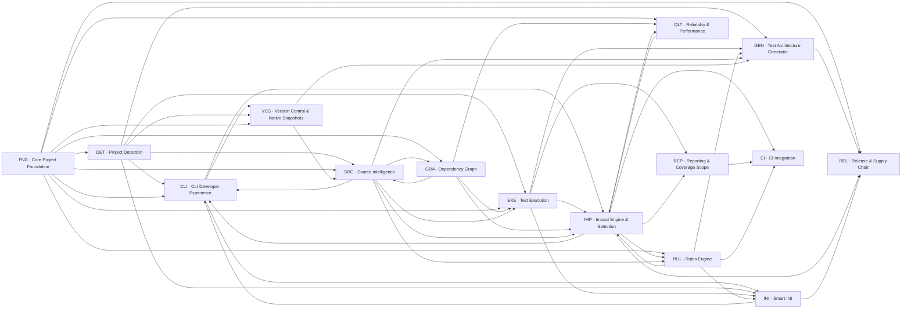

<!-- GENERATED by scripts/planning/generate-backlog.mjs from backlog.data.mjs — do not edit by hand. -->

# v1.0.0 epics

15 epics · 103 stories · 422 committed points (+6 stretch).

**Implementation (v0.2.0):** 389 / 422 committed points done · 10 partial · 2 todo.

| Epic | Name | Stories | Points | Done pts | Must | Should | Could | Sprints | Acceptance gate |
|---|---|---|---|---|---|---|---|---|---|
| [FND](FND-core-project-foundation.md) | Core Project Foundation | 13 | 39 | 30 | 13 | 0 | 0 | S0 | Core packages build and test independently. |
| [CLI](CLI-cli-developer-experience.md) | CLI Developer Experience | 5 | 18 | 18 | 4 | 1 | 0 | S1–S8 | Every 1.0 command supports --help, --json where relevant, non-TTY mode and stable exit codes. |
| [DET](DET-project-detection.md) | Project Detection | 7 | 27 | 27 | 6 | 1 | 0 | S1–S2 | Detection output matches expectations for every fixture in the catalogue. |
| [VCS](VCS-version-control-and-native-snapshots.md) | Version Control & Native Snapshots | 9 | 37 | 37 | 7 | 2 | 0 | S1–S10 | All 1.0 adapters produce consistent normalized changes within their declared capabilities. |
| [SRC](SRC-source-intelligence.md) | Source Intelligence | 9 | 50 | 47 | 8 | 1 | 0 | S2–S5 | Known source fixtures produce the expected symbols and relationships. |
| [GRA](GRA-dependency-graph.md) | Dependency Graph | 5 | 25 | 20 | 4 | 1 | 0 | S3–S5 | Dependency queries are reproducible and benchmarked. |
| [EXE](EXE-test-execution.md) | Test Execution | 7 | 35 | 35 | 5 | 2 | 0 | S4–S10 | Native runner results and SmartTest results remain consistent. |
| [IMP](IMP-impact-engine-and-selection.md) | Impact Engine & Selection | 9 | 39 | 39 | 8 | 1 | 0 | S5–S9 | No known reproducible failing test is missed in the defined validation fixtures. |
| [RUL](RUL-rules-engine.md) | Rules Engine | 5 | 24 | 24 | 4 | 1 | 0 | S6–S7 | Rule evaluation is deterministic and explainable. |
| [INI](INI-smart-init.md) | Smart Init | 8 | 33 | 33 | 8 | 0 | 0 | S7–S8 | Supported repositories can be initialised safely with minimal manual configuration. |
| [GEN](GEN-test-architecture-generator.md) | Test Architecture Generator | 7 | 36 | 36 | 5 | 2 | 0 | S8–S9 | Generation is repeatable and does not overwrite user content by default. |
| [REP](REP-reporting-and-coverage-scope.md) | Reporting & Coverage Scope | 7 | 26 | 26 | 5 | 2 | 0 | S9–S10 | Reports are accurate, portable and clear about skipped, cached and executed tests. |
| [CI](CI-ci-integration.md) | CI Integration | 3 | 8 | 5 | 2 | 0 | 1 | S10–STRETCH | CI integration remains deterministic and secure. |
| [QLT](QLT-reliability-and-performance.md) | Reliability & Performance | 4 | 16 | 10 | 3 | 0 | 1 | S6–STRETCH | Performance and selection-safety claims are reproducible under documented conditions. |
| [REL](REL-release-and-supply-chain.md) | Release & Supply Chain | 5 | 15 | 2 | 4 | 1 | 0 | S6–S10 | A new user can install, use and remove SmartTest following only the published docs. |

## Epic dependency flow

