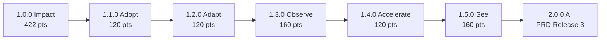

# Roadmap 1.1.0 → 1.5.0

> After 1.0.0 the 1.x line makes SmartTest **easier to adopt, more precise, faster and visible**, without breaking anything: every 1.x release is backwards compatible (config, exit codes, `--json` schemas).
> Planning is in **story points** (capacity 40 per sprint, same team model as 1.0). AI test engineering stays out of 1.x and becomes **2.0** (PRD Release 3), so the deterministic core is proven first.

Inputs: [PRD §35](../product/PRD.md#35-release-roadmap) (Releases 2–4), the [1.0 deferred list](release-1.0.0/README.md#explicitly-out-of-scope-planned-later), and the **LeadsIt case study** ([case-studies/leadsit.md](../case-studies/leadsit.md)), the first real repository migrated to SmartTest.

| Version   | Theme      | Points  | Sprints | Headline                                                                 |
| --------- | ---------- | ------- | ------- | ------------------------------------------------------------------------ |
| **1.1.0** | Adopt      | 120     | 3       | Zero-friction setup in any repo: hooks, CI, per-project conventions, npm |
| **1.2.0** | Adapt      | 120     | 3       | The config follows the project: `sync`, watch mode, E2E runners          |
| **1.3.0** | Observe    | 160     | 4       | Runtime evidence: per-test tracing, diff coverage, Shadow Mode           |
| **1.4.0** | Accelerate | 120     | 3       | Validated result cache, sharding, duration-aware scheduling              |
| **1.5.0** | See        | 160     | 4       | SmartTest Studio preview + VS Code extension, stable Plugin SDK          |
|           | **Total**  | **680** | **17**  |                                                                          |

---

## 1.1.0 — Adopt (120 pts)

**Goal:** a team installs SmartTest from npm, runs `init`, and its existing hook and CI switch to affected tests in under five minutes, in any repository shape.

| Epic         | Story                                                                                                                        | Pts |
| ------------ | ---------------------------------------------------------------------------------------------------------------------------- | --- |
| Distribution | Publish `smarttest` on npm with provenance and SBOM (closes ST-011, ST-099, ST-100)                                          | 5   |
| Distribution | `npx smarttest` works without a root `package.json` (multi-project repos like LeadsIt)                                       | 3   |
| Hooks        | `smarttest hook install / uninstall` for husky, lefthook, simple-git-hooks and plain `.git/hooks`, with marked blocks        | 8   |
| Hooks        | `init` proposes replacing detected full-suite hook steps, showing a diff and the measured savings (`benchmark --commits 10`) | 8   |
| Hooks        | Hook-friendly mode: `run --staged --fast-exit` stops at the first failure, with compact output                               | 3   |
| Conventions  | Per-project test layout and naming (FrontLeadsIt is colocated `*.server.test.ts`, backend is `__tests__/`)                   | 5   |
| Conventions  | Per-project rules: `rules` scoped by `project:` and suggested per project                                                    | 5   |
| Conventions  | Read runner include/exclude from config files statically (faster cold start than listing)                                    | 5   |
| CI           | GitLab CI, Jenkins, Azure Pipelines and CircleCI templates plus `smarttest ci detect`                                        | 8   |
| CI           | PR summary comment through `gh`/GitLab API (opt-in, no app needed)                                                           | 5   |
| CI           | `run --base origin/main` in shallow clones: auto-deepen fetch with a clear message                                           | 3   |
| Performance  | Adaptive policy (PRD §31.5): skip analysis when the projected full run is cheaper than the analysis                          | 5   |
| Performance  | Cold start under 1 s on 2,000 modules (parallel parsing in worker threads)                                                   | 8   |
| Fixtures     | React, Next.js, Yarn ESM, TS library and Wasp fixtures; Windows and macOS validated in CI (closes ST-005, ST-097)            | 13  |
| Policy       | CI quality gates: `--fail-on policy` (ST-094)                                                                                | 3   |
| Policy       | Performance regression job, nightly (ST-098)                                                                                 | 3   |
| TypeScript 7 | Spike plus adapter for the TS 7 native API behind `language-typescript`, with TS 6 kept as fallback                          | 13  |
| Docs         | Doc snippets executed in CI (closes ST-101); migration guides from Nx/Turbo affected and Jest `--changedSince`               | 8   |
| Buffer       | Bugs from 1.0 adopters                                                                                                       | 13  |

**Exit:** five external repositories initialised with no config edits; `benchmark` shows 0 missed failures on all five; 3-OS CI green.

## 1.2.0 — Adapt (120 pts)

**Goal:** SmartTest notices when the project changes and keeps itself correct. It also covers E2E suites.

| Epic            | Story                                                                                                           | Pts |
| --------------- | --------------------------------------------------------------------------------------------------------------- | --- |
| Adaptive config | `smarttest sync [--check]`: detect new projects, runners, aliases and VCS changes; propose an update (PRD §6)   | 13  |
| Adaptive config | `doctor --fix` for safe fixes (missing ignore, stale discovery cache, renamed config files)                     | 5   |
| Adaptive config | `migrate` between runners (Jest → Vitest) keeping history and rules                                             | 8   |
| Watch           | `smarttest watch`: re-run affected tests on save with an incremental index and graph patches (completes ST-047) | 13  |
| E2E             | Playwright adapter: discovery, file selection, traces linked in the report                                      | 13  |
| E2E             | Route/component → E2E mapping (static: page imports, route manifests)                                           | 13  |
| E2E             | Cypress adapter (spec selection, honest statuses)                                                               | 8   |
| Monorepo        | Read Nx/Turborepo project graphs as extra evidence (never as the only evidence)                                 | 8   |
| VCS             | SVN adapter (PRD §7.6) behind the existing contract                                                             | 13  |
| Generated code  | `rebuild-required` policy: generator input → output mapping (completes ST-043)                                  | 5   |
| Buffer          |                                                                                                                 | 21  |

**Exit:** a project that adds a package, switches runners and adopts Git mid-life never needs a manual re-init; Playwright selection validated with `benchmark`.

## 1.3.0 — Observe (160 pts)

**Goal:** add runtime evidence to static analysis. Selection gets tighter and every decision is proven against real executions.

| Epic     | Story                                                                                                               | Pts |
| -------- | ------------------------------------------------------------------------------------------------------------------- | --- |
| Tracing  | Per-test-file V8 coverage collection (Vitest/Jest/node:test) → `OBSERVED_EXECUTION` edges with provenance (PRD §12) | 21  |
| Tracing  | Trace invalidation by source and environment fingerprint; never reuse stale traces                                  | 8   |
| Tracing  | Hybrid selection: static ∪ observed, with explanations showing both                                                 | 8   |
| Coverage | Diff coverage (changed lines/branches) per run, labelled by scope (PRD §16)                                         | 13  |
| Coverage | Coverage quality gates per rule (`coverage.lines`, `coverage.branches` enforced)                                    | 8   |
| Coverage | Missing-protection report: changed code with no test reaching it                                                    | 8   |
| Trust    | Shadow Mode: periodic full run in CI that compares against selections and reports drift (PRD §32.4)                 | 13  |
| Trust    | `benchmark --since <date>` over hundreds of commits with sampling and a resumable run                               | 8   |
| Flaky    | Flaky analytics: history, failure rate and quarantine suggestions (never auto-skip)                                 | 13  |
| Reports  | Historical comparison in the HTML report (trend of time saved, fallback rate, flaky rate)                           | 8   |
| Mutation | Mutation-testing integration (Stryker) to score test strength, reported separately                                  | 13  |
| Buffer   |                                                                                                                     | 39  |

**Exit:** on the case-study repos, observed edges reduce selected tests by ≥ 20% with 0 missed failures in Shadow Mode over 30 days of commits.

## 1.4.0 — Accelerate (120 pts)

**Goal:** make the tests that do run finish faster.

| Epic        | Story                                                                                                             | Pts |
| ----------- | ----------------------------------------------------------------------------------------------------------------- | --- |
| Cache       | Validated result cache: content-addressed on test, sources, deps, config, runtime and adapter version (PRD §15.4) | 21  |
| Cache       | Cached results are always shown as `cached-pass`/`cached-failure`, never as fresh                                 | 3   |
| Cache       | Exclusion contract for tests that touch external state (network, time, env)                                       | 5   |
| Scheduling  | Duration-aware scheduling across runner groups (longest first, parallel groups)                                   | 8   |
| Scheduling  | CI sharding: `smarttest shard --total n --index i` balanced by recorded durations                                 | 13  |
| Scheduling  | Run independent runner roots in parallel with a CPU/memory budget                                                 | 8   |
| VCS         | Mercurial adapter                                                                                                 | 8   |
| Performance | Persistent graph with in-place patches (graph rebuild under 10 ms at 2,000 modules)                               | 13  |
| Performance | Optional SQLite store, if benchmarks on 10k+ module repos justify it (ADR-0003 revisit)                           | 8   |
| Buffer      |                                                                                                                   | 33  |

**Exit:** median CI time on the case-study repos down a further 30% versus 1.3; zero cache-integrity violations in the report-integrity suite.

## 1.5.0 — See (160 pts)

**Goal:** a visual layer on the proven engine (PRD §24), local and secure.

| Epic          | Story                                                                                            | Pts |
| ------------- | ------------------------------------------------------------------------------------------------ | --- |
| Studio        | `smarttest studio`: local web app on loopback, with session token and origin checks (PRD §24.14) | 13  |
| Studio        | Overview dashboard (health, last runs, time saved, warnings)                                     | 8   |
| Studio        | Test Explorer (projects → files → tests, run one/many, history)                                  | 13  |
| Studio        | Impact Map (interactive graph, path highlighting, export), reusing the motion design system      | 21  |
| Studio        | Live Runner (streamed results, cancel, retry, logs)                                              | 13  |
| Studio        | Coverage Viewer (annotated source with changed lines and diff coverage)                          | 13  |
| Studio        | Rules editor (visual, still stored as code)                                                      | 8   |
| IDE           | VS Code extension: CodeLens "protected by N tests", run affected for this file, explain on hover | 21  |
| SDK           | Plugin SDK 1.0: stable adapter contracts, conformance kit and docs; community adapters accepted  | 13  |
| Accessibility | WCAG 2.2 AA audit of Studio and the HTML report; keyboard-first navigation                       | 8   |
| Buffer        |                                                                                                  | 29  |

**Exit:** core workflows (run, explain, inspect impact, read coverage) possible without the CLI; Studio passes a security review.

---

## After 1.5: 2.0.0 (AI, optional)

PRD Releases 3+: provider manager, AI test generation on top of the generator's `it.todo` scaffolds, coverage audit, repair proposals. The deterministic core never depends on it (ADR-0004). Cloud (Release 5) and more languages (Release 6) follow.
